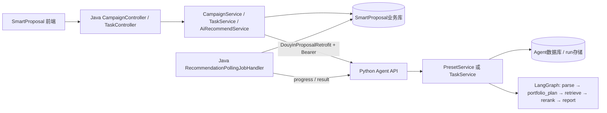

# Smart Proposal 业务代码索引

> 用途：后续生成 Smart Proposal Agent 第一阶段业务代码时，先读本文，再对照设计文档和本文链接的真实服务源码。本文只记录已检查到的代码事实，不替代 OpenAPI/业务 owner 的正式契约。两个外部仓库当前均为本机源码快照；生成业务代码时应重新核对所用分支/版本。

## 阅读顺序

1. [第一阶段嵌入式 Agent 技术实现文档](第一阶段嵌入式Agent技术实现文档.md)：产品目标、状态、持久化、安全和未决契约。
2. [Java CampaignController.java](</Users/huajun.yao/Documents/work/cn-buycoor-SocialSeedsManagement-SmartProposal-backend-main/src/main/java/com/buycoor/digital/social/proposal/controller/CampaignController.java>)：Campaign create/detail/update/delete 和 presets 路由入口。
3. [Java TaskController.java](</Users/huajun.yao/Documents/work/cn-buycoor-SocialSeedsManagement-SmartProposal-backend-main/src/main/java/com/buycoor/digital/social/proposal/controller/TaskController.java>)：任务创建、推荐启动、结果、圈选和最终封板接口。
4. [Java CampaignServiceImpl.java](</Users/huajun.yao/Documents/work/cn-buycoor-SocialSeedsManagement-SmartProposal-backend-main/src/main/java/com/buycoor/digital/social/proposal/service/impl/CampaignServiceImpl.java>)、[TaskServiceImpl.java](</Users/huajun.yao/Documents/work/cn-buycoor-SocialSeedsManagement-SmartProposal-backend-main/src/main/java/com/buycoor/digital/social/proposal/service/impl/TaskServiceImpl.java>)、[AiRecommendServiceImpl.java](</Users/huajun.yao/Documents/work/cn-buycoor-SocialSeedsManagement-SmartProposal-backend-main/src/main/java/com/buycoor/digital/social/proposal/service/impl/AiRecommendServiceImpl.java>)。
5. [Java DouyinProposalRetrofit.java](</Users/huajun.yao/Documents/work/cn-buycoor-SocialSeedsManagement-SmartProposal-backend-main/src/main/java/com/buycoor/digital/social/proposal/retrofit/DouyinProposalRetrofit.java>)、[RecommendationPollingJobHandler.java](</Users/huajun.yao/Documents/work/cn-buycoor-SocialSeedsManagement-SmartProposal-backend-main/src/main/java/com/buycoor/digital/social/proposal/job/RecommendationPollingJobHandler.java>)：下游 Douyin Agent API 与异步轮询。
6. [Python presets route](</Users/huajun.yao/Documents/work/cn-digital-SocialSeedsManagement-smartproposal-kol-tiktok/kol-selection-douyin-backend/src/api/routes/presets.py>) 和 [PresetService](</Users/huajun.yao/Documents/work/cn-digital-SocialSeedsManagement-smartproposal-kol-tiktok/kol-selection-douyin-backend/src/services/preset/service.py>)：推荐任务 presets 的真正处理逻辑。
7. [Python tasks route](</Users/huajun.yao/Documents/work/cn-digital-SocialSeedsManagement-smartproposal-kol-tiktok/kol-selection-douyin-backend/src/api/routes/tasks.py>)、[TaskService](</Users/huajun.yao/Documents/work/cn-digital-SocialSeedsManagement-smartproposal-kol-tiktok/kol-selection-douyin-backend/src/services/run/task_service.py>)、[RunGraphRunner](</Users/huajun.yao/Documents/work/cn-digital-SocialSeedsManagement-smartproposal-kol-tiktok/kol-selection-douyin-backend/src/services/run/run_graph.py>)：推荐 task create/execute/progress/result 的实际下游实现。

## 系统边界与主要调用链

- 用户侧业务 ID 是 Java SmartProposal 的 `Long campaignId/taskId`；Douyin Agent 的 `task_id` 是字符串下游 ID。Java 在推荐启动后保存 `downstreamTaskId`，轮询以这个 ID 调下游。不要混用 Agent 自建 `task_id`、SmartProposal `taskId` 和下游 `downstreamTaskId`。
- Java 通过 Retrofit 的配置 base URL 调下游 `api/...`，并自动添加 `Authorization: Bearer ...`。Java Controller 的 `/api/...` 外部完整路径还受部署 context path / proxy 影响；应读取部署配置，不能凭 UAT URL 前缀构造。
- 已看到 Python session username 会被 presets route 读取并传入 presets 数据查询；其他任务 API 以 `Request` 交给 service。Python 身份、token 和 account scope 的真实入口见 `src/api/security.py`、`src/services/auth/token_service.py`，不要绕过中间件或信任 Agent 请求体身份。

## Java SmartProposal 后端

根目录：`/Users/huajun.yao/Documents/work/cn-buycoor-SocialSeedsManagement-SmartProposal-backend-main`

| 文件 | 关键入口/责任 | 生成 Agent 代码时需遵守 |
|---|---|---|
| [CampaignController.java](</Users/huajun.yao/Documents/work/cn-buycoor-SocialSeedsManagement-SmartProposal-backend-main/src/main/java/com/buycoor/digital/social/proposal/controller/CampaignController.java>) | `POST /api/campaigns`、`GET /{id}`、`PUT /{id}`、`DELETE /{id}`、`POST /{id}/presets` | 创建/详情等返回 Venus `BaseResponseEntity`；创建 DTO 用 `brandName`，不是前端 brandId。活动不需要 Agent 专属确认门槛。注意文档注释与当前实现的删除语义可能不一致，勿依注释猜删除逻辑。 |
| [CampaignCreateDTO.java](</Users/huajun.yao/Documents/work/cn-buycoor-SocialSeedsManagement-SmartProposal-backend-main/src/main/java/com/buycoor/digital/social/proposal/dto/campaign/CampaignCreateDTO.java>) | Campaign create 输入约束 | 必填：`brandName/platform/product/sellingPoint/persona`；`name/title/type/budget/startDate/endDate/emotion/coreSellingPoint/competitors` 可选。金额 `BigDecimal` 元，日期 `LocalDate`。与 UAT 表单“标题必填”等 UI 行为有差异；后端 DTO 是服务契约事实，需和 UI/业务确认 Agent 校验口径。 |
| [CampaignServiceImpl.java](</Users/huajun.yao/Documents/work/cn-buycoor-SocialSeedsManagement-SmartProposal-backend-main/src/main/java/com/buycoor/digital/social/proposal/service/impl/CampaignServiceImpl.java>) | create 时平台枚举校验、品牌名查表并落 `brandCode`、字段落库；详情回填品牌和统计；update 不允许改平台/品牌；presets 调下游 | Presets 先读 Campaign 的 `brandCode`；缺品牌/下游异常时返回 `null`（不是带业务错误的数据）。日期开始转当天 00:00，结束转 23:59:59。Campaign 删除的注释与 `deleteById` 实际调用需结合 MyBatis-Plus 全局逻辑删除配置核实。 |
| [TaskController.java](</Users/huajun.yao/Documents/work/cn-buycoor-SocialSeedsManagement-SmartProposal-backend-main/src/main/java/com/buycoor/digital/social/proposal/controller/TaskController.java>) | task CRUD、recommend、results、`batch-select`、`batch-finish`、`batch-confirm-selection` | 路径根 `/api/campaigns/{campaignId}/tasks`。推荐启动请求没有 body。`batch-select` 是可多任务/多 KOL 的立即圈选操作；另有 `batch-confirm-selection` 保存圈选后封板，是最终完成流程的重要候选 API。 |
| [TaskCreateDTO.java](</Users/huajun.yao/Documents/work/cn-buycoor-SocialSeedsManagement-SmartProposal-backend-main/src/main/java/com/buycoor/digital/social/proposal/dto/task/TaskCreateDTO.java>) | 任务创建字段与 Bean Validation | 必填：`kolCount/budget/tierDistribution/talentType`；任务 `name` 和 `talkingAngle/scene/contentPreference/talentAbility/remark` 可选。任务无 platform 字段，平台从 Campaign 继承。 |
| [TaskServiceImpl.java](</Users/huajun.yao/Documents/work/cn-buycoor-SocialSeedsManagement-SmartProposal-backend-main/src/main/java/com/buycoor/digital/social/proposal/service/impl/TaskServiceImpl.java>) | 建任务初始 `PENDING`；更新清理旧推荐状态并回到 pending；启动委托 AiRecommend；封板状态检查 | 更新/删除受任务状态约束。任务创建后还要显式 start recommendation。 |
| [AiRecommendServiceImpl.java](</Users/huajun.yao/Documents/work/cn-buycoor-SocialSeedsManagement-SmartProposal-backend-main/src/main/java/com/buycoor/digital/social/proposal/service/impl/AiRecommendServiceImpl.java>) | 校验 campaign/task 归属和状态、继承平台、并发占位、下游 create+execute、存 `downstreamTaskId` | 下游 brief 由 Campaign 的品牌、人群、产品字段与 Task 的 `kol_requirements` 组合；任务预算 `BigDecimal` 转 `int`。启动是异步受理，不等于候选已完成。下游异常可能将 SmartProposal 任务置 FAILED；超时和重试语义需对照实现及业务 owner。 |
| [DouyinProposalTaskCreateDTO.java](</Users/huajun.yao/Documents/work/cn-buycoor-SocialSeedsManagement-SmartProposal-backend-main/src/main/java/com/buycoor/digital/social/proposal/dto/douyinproposal/DouyinProposalTaskCreateDTO.java>) | Java 到 Python `POST api/tasks` 的 snake_case 载荷 | 根含 `brand,target_audience,product,kol_requirements`；具体嵌套字段见源码。adapter 应按该 DTO 映射，不要把前端 camelCase 直接透传。 |
| [DouyinProposalRetrofit.java](</Users/huajun.yao/Documents/work/cn-buycoor-SocialSeedsManagement-SmartProposal-backend-main/src/main/java/com/buycoor/digital/social/proposal/retrofit/DouyinProposalRetrofit.java>) | 下游接口声明与超时/认证 | `POST api/tasks` → `POST api/tasks/{task_id}/execute` → `GET .../progress` / `GET .../result`；`POST api/presets/campaign`；Bearer token 注解。连接/读/写 timeout 配为 5 分钟。 |
| [RecommendationPollingJobHandler.java](</Users/huajun.yao/Documents/work/cn-buycoor-SocialSeedsManagement-SmartProposal-backend-main/src/main/java/com/buycoor/digital/social/proposal/job/RecommendationPollingJobHandler.java>) | XXL Job `recommendationPollingJobHandler` 每 30 秒轮询 Java IN_PROGRESS 且有下游 ID 的任务 | progress 0–1 转百分比；completed 后 query result，将结果 JSON 存 `kol_result`，更新 recommendCount、100% 和 RECOMMEND_COMPLETED；failed 则转 FAILED。Agent 可通过 Java task list/detail/results 读业务状态，不应另造并行推荐状态。 |
| [RecommendationServiceImpl.java](</Users/huajun.yao/Documents/work/cn-buycoor-SocialSeedsManagement-SmartProposal-backend-main/src/main/java/com/buycoor/digital/social/proposal/service/impl/RecommendationServiceImpl.java>) | 从结果 JSON、圈选表、风险表构建结果 VO 与 summary；实现圈选记录 | `source` 来自 recommend/backup/lookalike；用户选择是另一张 selection 表，不等于模型 shortlist。summary 的 `shortlistCount` 是用户已选数；预算/指标仅对用户已选者汇总。 |
| [SelectionConfirmServiceImpl.java](</Users/huajun.yao/Documents/work/cn-buycoor-SocialSeedsManagement-SmartProposal-backend-main/src/main/java/com/buycoor/digital/social/proposal/service/impl/SelectionConfirmServiceImpl.java>) | `confirm` 在 `@Transactional(rollbackFor=Exception.class)` 中先 `selectKol` 再 `finishTasks`，最后返回活动已选 KOL 分组 | 这是代码中明确的“圈选 + 封板”原子业务操作；调用前仍需业务确认它是否为 Agent 最终确认的产品入口，并核对回执、重复提交及失败重放策略。Agent 最终确认应考虑该 API，不能把普通 `batch-select` 当封板。 |
| [SelectionRequestDTO.java](</Users/huajun.yao/Documents/work/cn-buycoor-SocialSeedsManagement-SmartProposal-backend-main/src/main/java/com/buycoor/digital/social/proposal/dto/task/SelectionRequestDTO.java>)、[SelectionConfirmRequestDTO.java](</Users/huajun.yao/Documents/work/cn-buycoor-SocialSeedsManagement-SmartProposal-backend-main/src/main/java/com/buycoor/digital/social/proposal/dto/task/SelectionConfirmRequestDTO.java>) | 圈选/确认载荷 | `items[]: {taskId,kols[]}`；每 KOL 条目由 `kolBackendId/selected/rejected/rejectReason` 决定 select/cancel/reject，同一请求可混合操作。确认请求继承相同结构。 |

### 关键外部接口映射

| SmartProposal API | 下游行为/读取 |
|---|---|
| `POST /api/campaigns` | 本地创建 Campaign；Java `brandName` 查品牌并存 brandCode |
| `POST /api/campaigns/{campaignId}/presets` | Java 查 Campaign，形成 `{brand_code,spu,per_category_limit:8}`，调用 Python `POST /api/presets/campaign` |
| `POST /api/campaigns/{campaignId}/tasks` | 本地创建 task（初始 PENDING），平台由 Campaign 继承 |
| `POST /api/campaigns/{campaignId}/tasks/{taskId}/recommend` | Java 并发/状态校验 → Python create task + execute task → 保存下游 ID → 立即返回成功响应 |
| `GET /api/campaigns/{campaignId}/tasks` 或 `/{taskId}` | 查询 Java 任务状态、progress、downstream ID 等 |
| `GET /api/campaigns/{campaignId}/tasks/{taskId}/results` | 返回 Java 合并结果、来源、圈选状态和 summary |
| `POST /api/campaigns/{campaignId}/tasks/batch-select` | 立即写圈选/取消/拒绝记录及历史；不封板任务 |
| `POST /api/campaigns/{campaignId}/tasks/batch-confirm-selection` | 圈选写入 + 任务封板 + 返回已选 KOL 分组（事务） |
| `POST /api/campaigns/{campaignId}/tasks/batch-finish` | 只封板；应由统一 confirm 流程优先，勿拆成两个不可原子写操作 |

## Python 抖音选人 Agent 服务

根目录：`/Users/huajun.yao/Documents/work/cn-digital-SocialSeedsManagement-smartproposal-kol-tiktok/kol-selection-douyin-backend`

| 文件 | 关键入口/责任 | 与 Java/Agent 的关系 |
|---|---|---|
| [src/api/app.py](</Users/huajun.yao/Documents/work/cn-digital-SocialSeedsManagement-smartproposal-kol-tiktok/kol-selection-douyin-backend/src/api/app.py>) | FastAPI app 和 router 挂载 | presets、tasks、runs 等实际 routes 在此挂载；确认 middleware/security 后再调用。 |
| [src/api/routes/presets.py](</Users/huajun.yao/Documents/work/cn-digital-SocialSeedsManagement-smartproposal-kol-tiktok/kol-selection-douyin-backend/src/api/routes/presets.py>) | `POST /api/presets/campaign` 与 `/catalog/summary` | 主请求取 session username，标准化后传 PresetService；返回统一 success envelope。路径与 Java Retrofit 一致。 |
| [src/services/preset/models.py](</Users/huajun.yao/Documents/work/cn-digital-SocialSeedsManagement-smartproposal-kol-tiktok/kol-selection-douyin-backend/src/services/preset/models.py>) | Pydantic request/response | 必填 `brand_code`，可选 `spu`，`per_category_limit` 默认 8、范围 4–20；返回 `matched` 和四类 string list presets。内部 suggestions 的 source/scope/evidence 不出现在最终 `PresetValues`。 |
| [src/services/preset/service.py](</Users/huajun.yao/Documents/work/cn-digital-SocialSeedsManagement-smartproposal-kol-tiktok/kol-selection-douyin-backend/src/services/preset/service.py>) | brand code 映射、catalog + 用户/共享 DB 建议合并、来源优先级去重截断 | `owner_run_history > approved_historical_brief > approved_database_snapshot > shared_database > controlled_taxonomy`；响应只返回 values 和匹配策略。前端建议不能自动当用户条件。 |
| [src/services/preset/catalog.py](</Users/huajun.yao/Documents/work/cn-digital-SocialSeedsManagement-smartproposal-kol-tiktok/kol-selection-douyin-backend/src/services/preset/catalog.py>) | catalog DB 载入、品牌/SPU 匹配与安全 fallback | 能返回 `exact_mainstream_spu` 或 `brand_fallback`；SPU 不匹配会回退品牌主要品类，必须保留匹配策略，不能宣称精确产品匹配。 |
| [src/services/preset/database.py](</Users/huajun.yao/Documents/work/cn-digital-SocialSeedsManagement-smartproposal-kol-tiktok/kol-selection-douyin-backend/src/services/preset/database.py>) | owner run history、approved brief 和共享数据库候选来源 | 用户 scope 来自 session username；读取失败/回退要如实处理，不能把其他 owner 数据当个人偏好。 |
| [src/api/routes/tasks.py](</Users/huajun.yao/Documents/work/cn-digital-SocialSeedsManagement-smartproposal-kol-tiktok/kol-selection-douyin-backend/src/api/routes/tasks.py>) | `POST /api/tasks`、`POST /{id}/execute`、`GET /{id}/progress`、`GET /{id}/result` | create 产生字符串 task/run ID；execute 走队列非阻塞；progress/result 通过 service 读取。 |
| [src/domain/dto.py](</Users/huajun.yao/Documents/work/cn-digital-SocialSeedsManagement-smartproposal-kol-tiktok/kol-selection-douyin-backend/src/domain/dto.py>) | `CreateTaskRequest/TargetAudience/ProductInfo/KolRequirements/TaskProgressResponse/TaskResultResponse/KolResult` | Python 入参是 snake_case 嵌套结构，数量 int、预算 float；与 Java DTO 有 `budget BigDecimal → int` 及字段命名转换。结果 `shortlist/backup` 是模型分组标记。 |
| [src/services/run/task_service.py](</Users/huajun.yao/Documents/work/cn-digital-SocialSeedsManagement-smartproposal-kol-tiktok/kol-selection-douyin-backend/src/services/run/task_service.py>) | 结构化 JSON 转 V1 brief、create run、异步执行、progress/result 组装 | `create_task` 保存原始 v2 input 并创建 run；`execute_task` 经 lifecycle queue；result 受 parse target 数量裁剪。 |
| [src/services/run/run_graph.py](</Users/huajun.yao/Documents/work/cn-digital-SocialSeedsManagement-smartproposal-kol-tiktok/kol-selection-douyin-backend/src/services/run/run_graph.py>) | LangGraph 阶段守卫、checkpoint、clarification interrupt/resume、恢复调度 | 实际阶段来自 RunRepository；有 PostgresSaver。此为下游推荐引擎内部图，不是新 Agent 的业务图。 |
| [src/services/run/run_orchestrator.py](</Users/huajun.yao/Documents/work/cn-digital-SocialSeedsManagement-smartproposal-kol-tiktok/kol-selection-douyin-backend/src/services/run/run_orchestrator.py>) | 装配 Parse/Plan/Retrieve/Rerank/Report 服务和 stage dispatch | 领域判断属于 domain/stage 服务，图负责路由。新 Agent 应编排其 API，而非耦合其内部 graph/repository。 |
| [src/api/security.py](</Users/huajun.yao/Documents/work/cn-digital-SocialSeedsManagement-smartproposal-kol-tiktok/kol-selection-douyin-backend/src/api/security.py>)、[src/services/auth/token_service.py](</Users/huajun.yao/Documents/work/cn-digital-SocialSeedsManagement-smartproposal-kol-tiktok/kol-selection-douyin-backend/src/services/auth/token_service.py>) | token/session 校验与 account scope | Python 仓库 AGENTS 指定此为唯一鉴权入口；不要使用过时 `settings.API_KEY` 路径或读取 `.env` 内容。 |

### Python 推荐流水线索引

`src/services/run/run_orchestrator.py` 装配以下确定阶段，具体业务实现及配置从这些路径继续查：

| 阶段 | Service | 领域/策略位置 |
|---|---|---|
| parse | `src/services/pipeline/parse_service.py` | `src/domain/brief_heuristics.py`、`src/domain/clarification_inference.py`、`src/agents/` |
| portfolio_plan | `src/services/pipeline/portfolio_plan_service.py` | `src/domain/planning.py`、`src/domain/ranking/portfolio_plan.py` |
| retrieve | `src/services/pipeline/retrieve_service.py` | `src/domain/retrieval/runner.py`、`routes.py`、`hard_filters.py`、`candidate_merge.py` |
| rerank | `src/services/pipeline/rerank_service.py` | `src/domain/ranking/scoring.py`、`fit_scoring.py`、`portfolio.py`、`campaign_rules.py` |
| report | `src/services/pipeline/report_service.py` | `src/domain/dto.py` 结果 DTO 与报告投影 |

`src/api/routes/runs.py` 是更完整的 run 状态/消息/控制 API；当设计需要比 Java Retrofit 暴露更多状态时，先评审是否通过 Java 服务集成，不要让 Agent 直接绕过 Java 访问未约定的 run API。

## 字段和语义映射提醒

| 业务概念 | Java Campaign/Task 字段 | Python Agent 输入字段 | 边界 |
|---|---|---|---|
| 品牌 | Campaign create `brandName`，Java 查表存 `brandCode` | `brand`（下游 create task 使用） | Java presets 传短码；Python presets 再做前端短码到 catalog brand_code 的映射。 |
| 目标人群/情绪 | Campaign `persona/emotion` | `target_audience.persona/emotion` | persona 是 Java 必填；emotion 可选。 |
| 产品 | `product/sellingPoint/coreSellingPoint/competitors` | `product.name/selling_points/core_buying_points/competitors` | 字段经 Java `AiRecommendServiceImpl` 组装，不将产品名/功效编造进 brief。 |
| 任务 | `name/kolCount/budget/tierDistribution/talkingAngle/talentType/scene/contentPreference/talentAbility` | `kol_requirements.task_name/count/budget/tier_distribution/talking_angles/creator_types/scenarios/content_preferences/creator_capabilities` | UAT API 对外 camelCase；Java Retrofit 对下游 snake_case。任务 platform 从 Campaign 继承，不放入 task request。 |
| 推荐角色 | Python 结果字段 `shortlist/backup`，Java 结果 VO `source` | 结果 JSON 中 `kols[]` | 推荐拟选与用户圈选是不同事实；Java results 再叠加用户 selected/rejected 和风险数据。理由字符串不具权威结构语义。 |

预算尤其注意：Campaign 总预算、Java task budget（`BigDecimal` 元）、下游 `kol_requirements.budget`（Java 转 int，Python DTO float）及各 KOL 多规格报价不是同一个字段；不得未经确认做单位换算或推断超支。

## 已知契约差异 / 待确认项

1. UAT 观察到 Java API 业务响应 `code=200,data=<id>`，但 Agent 接入需同时检查 HTTP 与 envelope；Java `CampaignCreateDTO` 的 required annotation 与 UAT UI 必填标记存在差异，最终以服务校验和产品决策共同确定澄清行为。
2. `POST .../tasks/batch-select` 是逐 KOL select/cancel/reject 的持久化圈选操作并写历史；它不是“未保存到服务端的草稿”。Java 已有 `POST .../tasks/batch-confirm-selection`，在单事务中圈选并封板所涉任务为 ended。代码行为已明确；仍需产品/业务确认这是否就是 Agent 最终确认入口，并核对其业务回执、重复提交及失败重放策略。
3. Java Retrofit 将 HTTP 网络调用、数据库状态变更分开；下游 create 成功但 execute/响应超时的 unknown 及幂等恢复需查具体客户端拦截器和现有补偿任务。不要在新 Agent 里盲目重试。
4. 结果是否涵盖全部参与候选，要以 Java 保存的完整下游 result JSON 和 Python `quantity_target` 逻辑核对；不能把页面默认展示数、downstream requested count 或 `shortlistCount` 当候选 total。
5. 当前项目实现应通过 Java SmartProposal API 编排已有服务，除非架构 owner 明确批准直接调用 Python；避免 Agent 直接操作两个业务数据库或绕过 Java 的任务状态机/圈选事务。
6. 参考仓库的 `AGENTS.md` 是各自仓库规则，不自动约束当前项目；Python 仓库特别规定 token 鉴权唯一入口、OpenAI-compatible chat（无 Responses API）、数据库/服务分层，以及禁止读取或提交 `.env`。

## 当前 Agent 工程映射

当前目录代码索引见 [CODE_INDEX.md](CODE_INDEX.md)。新增业务逻辑预计落在：

- `app/services/adapters/`（后续创建）：只调用 Java SmartProposal API，按本索引映射 typed request/response。
- `app/graphs/campaign/`：围绕 Campaign → task → recommendation polling → result review → selection confirmation 编排；下游推荐自己的内部图不嵌入 Agent graph。
- `app/schemas/`：分开 Java API camelCase contract、领域模型和 Agent UI/event 类型，显式处理 Long ID 与下游字符串 ID。
- `app/workers/` 与 `app/repositories/`：推荐 polling/unknown 对账、会话事件及幂等台账；不另存 Java 已有业务真相。
- `app/prompts/`：Campaign/任务抽取与澄清只产生经过 Pydantic 验证的 patch；不能生成自由 API URL、品牌权限或确认状态。

以上是后续代码落点建议，不表示这些模块已实现。生成前复核各源码当前分支、Java controller 的部署路径和未决的最终确认契约。
