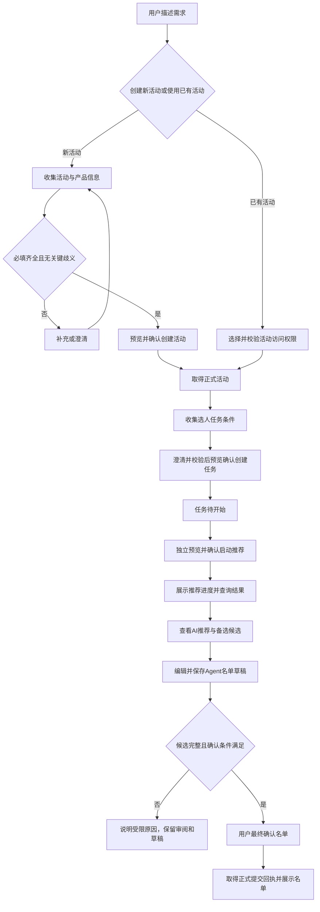

# SmartProposal 嵌入式 Agent 产品需求文档（PRD）

| 项目 | 内容 |
| --- | --- |
| 产品名称 | Smart Proposal Agent |
| 需求阶段 | 第一阶段：活动创建、达人推荐与名单确认闭环 |
| 文档版本 | V1.0 |
| 整理日期 | 2026-11-20 |
| 文档状态 | 需求评审稿，依据当前项目设计文档整理；不代表功能已全部实现或外部接口已验收 |
| 目标用户 | 在 SmartProposal 工作台为不同品牌执行活动与选人任务的内部运营人员 |
| 交付形态 | 现有 SmartProposal 工作台中的左侧嵌入式 Agent 面板，以及配套会话、表单、推荐和名单确认能力 |

## 1. 文档依据与需求口径

本 PRD 将现有技术方案、实施计划、专项复盘、流程图和原型中的产品要求整理为可评审、可开发、可验收的需求。正式业务系统继续负责 Campaign、选人任务、推荐结果和正式名单；Agent 负责交互、流程编排、草稿、用户确认和恢复。

### 1.1 主要依据

| 编号 | 材料 | 本文采用的内容 |
| --- | --- | --- |
| D1 | [第一阶段嵌入式Agent技术实现文档.md](第一阶段嵌入式Agent技术实现文档.md) | 产品范围、原型映射、UAT 字段、候选卡、会话恢复、输入分流和表单同步 |
| D2 | [第一阶段嵌入式Agent实施计划.md](第一阶段嵌入式Agent实施计划.md) | 交付目标、依赖、里程碑与发布标准 |
| D3 | [Agent专项设计复盘.md](Agent专项设计复盘.md) | 尤其是第 10.14—10.18 节的后续确认决策、多 workflow 和当前实施边界 |
| D4 | [第一阶段内部实施子阶段TODO.md](第一阶段内部实施子阶段TODO.md) | 当前实现进度、尚未完成的验收与外部依赖 |
| D5 | [BUSINESS_CODE_INDEX.md](BUSINESS_CODE_INDEX.md) | 业务字段、预算语义、服务边界和名单保存/封板区别 |
| D6 | [第一阶段内部运营助手技术方案初稿.md](第一阶段内部运营助手技术方案初稿.md) | 字段来源、默认值优先级、临时条件与长期偏好语义；范围冲突时采用后续文档 |
| D7 | [ProcessOn流程图.mmd](ProcessOn流程图.mmd)、[ProcessOn多Workflow场景.mmd](ProcessOn多Workflow场景.mmd)、[ProcessOn时序图.mmd](ProcessOn时序图.mmd) | 多工作流切换及创建、推荐、查询、名单审阅流程 |
| D8 | [组合工作台原型](原型图/SmartProposal%20Agent%20DEMO/proposal.html)、[活动创建原型](原型图/SmartProposal%20DEMO/smart-proposal-campaign-create.html)、[选人结果原型](原型图/SmartProposal%20DEMO/smart-proposal-kolRec-detail.html) | 布局和信息层级参考；静态原型不作为已实现功能或正式接口依据 |

### 1.2 新旧设计冲突的处理

| 事项 | 本 PRD 采用的口径 | 依据 |
| --- | --- | --- |
| 产品范围 | 覆盖新建/选择活动、创建选人任务、启动推荐、审阅候选和最终确认名单 | D1、D2，覆盖早期仅讨论 KOL 推荐的范围 |
| 创建与推荐确认 | 创建 Campaign、创建选人任务、启动推荐分别预览并独立确认 | D3 第 10.14 节已确认决策；D1 部分旧段落仍存在“自动创建/不额外确认”表述 |
| 会话与工作流 | 一个会话可以包含多个独立 workflow，通常只有一个当前交互 workflow；每条消息只路由到一个明确目标 | D3 第 10.14 节、D7，覆盖早期单活动任务的限制 |
| 名单保存 | 先保存 Agent 草稿；调用正式系统保存圈选需单独满足已确认的契约与授权条件 | D3、D4、D5 |
| 最终确认 | 产品采用 `batch-confirm-selection` 语义；`batch-select` 不等于最终确认 | D3、D5；真实部署契约、回执与幂等仍待验证 |
| 候选不完整 | 允许查看已取得候选和编辑 Agent 草稿，禁止最终确认 | D3、D4 |
| 字段范围 | 采用当前业务契约；原型中的 KPI、平台预算拆分、Tier 单人金额上限暂不纳入 | D1 的 UAT 字段复核 |

本文中的“必须”表示目标产品要求；“待确认”表示尚需责任方明确的业务或接口事项。现状说明依据项目文档记录，不将本地测试、一次 UAT 观察或设计完成等同于产品验收完成。

## 2. 背景、问题与目标

运营人员需要在活动、产品信息、选人条件、推荐结果和名单之间连续操作，并反复补充或调整需求。Agent 应允许用户直接描述目标，把自然语言转为可检查的结构化草稿，减少重复填写，同时让用户明确知道当前在处理哪个品牌、活动和任务。

第一阶段重点解决以下问题：

- 活动与选人信息分散在多步表单中，用户需要反复填写和解释需求。
- 金额、日期、平台、Tier 等表达容易产生歧义，错误理解会传入推荐流程。
- AI 推荐、备选候选、用户圈选和最终名单容易混淆，用户缺少清晰的审阅与确认过程。
- 长任务、页面刷新、面板关闭和多任务切换容易造成上下文或处理进度丢失。
- 品牌默认和个人习惯需要复用，但临时条件不能被误存为长期偏好。

产品目标是让用户通过“描述需求 → 澄清 → 核对 → 分阶段确认 → 审阅名单 → 最终确认”完成选人流程，做到字段可追溯、候选范围透明、业务操作可恢复、品牌数据隔离。

### 2.1 成功标准

| 目标 | 可观察结果 |
| --- | --- |
| 正确收集需求 | 自然语言和手动编辑更新同一份草稿；修改指定字段不丢失其他条件 |
| 正确执行业务 | 未澄清或未确认时不执行对应写操作；重复确认不重复创建或提交 |
| 透明展示结果 | 分开显示 AI 推荐、备选、用户已选和最终名单，数量及来源可解释 |
| 持续完成任务 | 刷新、断线、切换工作流和服务重启后能恢复资料、待处理问题与状态 |
| 正确复用偏好 | 新会话使用有效的适用偏好；跨品牌不串用；撤销后停止使用 |

## 3. 用户、角色与核心场景

| 角色 | 主要诉求 | 权限边界 |
| --- | --- | --- |
| 品牌运营人员 | 创建活动、补齐选人条件、获取推荐、调整并确认名单、管理个人偏好 | 仅操作本人及被授权品牌和业务对象 |
| 品牌规则维护者 | 维护品牌共享默认配置及强制规则 | 沿用既有管理权限；本期不另建品牌配置管理系统 |
| 业务验收人员 | 验证字段、推荐结果、预算解释、名单提交和恢复体验 | 使用获授权的测试数据和环境 |

核心用户故事：

1. 作为运营人员，我希望一次描述活动和产品信息，由 Agent 补齐缺项并生成活动草稿，核对后创建活动。
2. 作为运营人员，我希望选择已有活动继续创建选人任务，避免重复建立活动。
3. 作为运营人员，我希望说“把任务预算改成两万，其他不变”，只修改相关字段，并重新核对受影响的操作。
4. 作为运营人员，我希望看见 AI 推荐和更多候选，自主增删名单，最后明确确认提交。
5. 作为运营人员，我希望在活动 A 推荐期间新建活动 B，再切回 A 时仍能继续原来的任务。
6. 作为运营人员，我希望刷新页面或重新登录后找到历史会话，继续待确认的步骤。
7. 作为运营人员，我希望明确保存当前品牌下的个人偏好，并随时查看、修改和撤销。

## 4. 第一阶段范围与优先级

本文使用 P0 表示第一阶段闭环必需项，P1 表示可在试点后增加的增强项。P0 不表示当前已经实现。

| 优先级 | 需求范围 | 说明 |
| --- | --- | --- |
| P0 | 嵌入面板与品牌/对象上下文 | 左侧面板、收起/展开、关联活动与任务 |
| P0 | 会话与多工作流 | 新建、历史列表、恢复、工作流列表和切换 |
| P0 | 自然语言收集与澄清 | 活动/产品/任务字段提取、局部修改、缺失及歧义处理 |
| P0 | 结构化表单同步 | 聊天与表单一致、字段来源、版本冲突处理 |
| P0 | 分阶段业务操作 | Campaign 创建、任务创建、推荐启动各自独立确认 |
| P0 | 推荐进度与结果 | 受理/处理中/完成/失败区分、异步状态、真实结果展示 |
| P0 | 候选审阅与最终确认 | 候选完整性、用户选择草稿、版本校验、正式回执 |
| P0 | 明确长期偏好 | 查看、保存、编辑、停用、删除及品牌隔离 |
| P0 | 恢复、权限与重复保护 | 刷新/重启恢复、超时对账、重复事件保护、后端鉴权 |
| P1 | 会话管理增强 | 标题修改、搜索、归档等，是否进入首版由产品评审确定 |
| P1 | 行为偏好建议 | 多任务行为最多形成候选，用户接受后才生效 |

以下不进入第一阶段默认交付：独立 Agent 首页、智能问数、内容洞察、Pre-Check、KOL 分层总结、通用工具调用、自动激活推断偏好、未经批准的历史案例向量搜索。原型出现这些入口不构成需求承诺。

语音转文字仅保留设计，需单独通过识别效果、数据使用和成本评估后确定范围与排期；不作为当前首阶段验收前置。若后续纳入，应先进入输入框草稿，由用户检查并点击发送，识别完成不能自动发消息或触发业务。

## 5. 产品入口与信息架构

在现有 SmartProposal 工作台左侧增加 Agent 面板，保留原业务导航和活动、任务页面。原型约 360px 宽度仅供布局参考，生产宽度、窄屏折叠及具体挂载路由由 UI 评审确定。

| 区域 | 必须呈现的信息与操作 |
| --- | --- |
| 面板头部 | Agent 名称、当前品牌、新建会话、历史会话入口、收起操作 |
| 工作流区域 | 当前工作流名称、关联活动/任务、阶段；查看和切换其他工作流 |
| 对话区域 | 用户消息、Agent 回复、澄清问题、字段变更、操作预览和结果卡 |
| 输入区域 | 文本输入、发送、处理中反馈和可恢复错误提示 |
| 表单区域 | 当前活动/产品/任务草稿、字段来源、缺失/错误项、待确认状态；可结合现有业务表单承载 |
| 候选审阅区域 | AI 推荐、备选/更多结果、用户已选摘要、草稿保存与最终确认 |
| 偏好入口 | 已保存偏好列表，展示作用范围、来源、状态和有效期 |

面板收起不取消已受理任务，重新展开应恢复原会话与状态。阶段反馈必须可用；是否增加逐字流式回复属于待评审体验增强项。

## 6. 核心业务流程

已有活动路径跳过活动创建步骤。新建 Agent 工作流只建立流程草稿，不等于已经创建正式活动或选人任务。创建活动成功而后续失败时，保留正式活动并从失败阶段继续。

## 7. 功能需求

### FR-01 嵌入面板与页面上下文（P0）

- 面板应展示当前品牌、当前工作流及关联活动/任务，避免用户不清楚修改目标。
- 页面提供的活动/任务引用必须重新校验权限与归属，不能把页面文案或 URL 当作授权依据。
- 当前页面与工作流对象不一致时，明确显示关联差异，允许用户选择继续原流程或建立新流程。
- 切换页面本身不创建活动、不启动推荐、不将旧草稿自动写入新页面。
- 其他工作流的后台结果应更新其自身状态，不能覆盖当前工作流的表单或名单。

### FR-02 会话、新建与历史恢复（P0）

- 支持创建新会话、分页查看本人有权访问的历史会话、打开并继续旧会话。
- 历史列表至少显示标题、品牌、最近活动时间和状态摘要；标题编辑、搜索、归档和删除范围待评审。
- 恢复时显示消息、工作流列表、当前工作流、草稿、已保存字段来源、待回答问题、待确认卡和执行状态。
- 打开或读取历史会话只恢复展示，不自动创建业务对象、重发请求或唤起新的模型执行。
- 未兼容的历史状态允许查看已授权消息和结果，明确提示暂不能继续编辑，不能静默跳过确认。
- 品牌切换不能改写旧会话或工作流的品牌绑定。跨品牌列表展示与恢复入口策略按第 15 节确定。

### FR-03 一个会话中的多工作流（P0）

- 同一会话保留多个独立工作流，界面明确标识当前交互对象。
- “预算改成两万”等普通补充默认应用于当前工作流；每条消息只处理一个明确目标。
- 用户明确要求新建活动或任务时建立新工作流并切换；正式业务对象仍需收集字段和独立确认。
- “继续任务 A”等明确切换请求需先解决对象唯一性与权限，再加载该工作流的资料和进度。
- 同名、多义或不能确定是在新建活动还是任务时先询问，不能猜测目标或向多个工作流广播修改。
- 切换时提示旧工作流尚未完成；旧草稿、待确认卡、推荐进度、结果和待对账状态保持独立。
- 切换不要求先完成或取消旧工作流，也不自动取消、重启、再次提交其业务操作。
- 首版一次选人审阅/确认绑定一个明确业务任务；单个工作流是否承载多个任务不在本期扩展，见待决事项。

### FR-04 自然语言理解、澄清与能力反馈（P0）

- 支持一次输入包含活动、产品和任务信息，并按各阶段字段要求整理，不机械要求用户模拟页面点击顺序。
- 支持继续补充和局部修改；未提及字段保留原值，不能每轮重置完整表单。
- “预算两万”未说明是活动总预算、选人任务预算还是单人报价时，应先澄清，不自行归属。
- 缺必填、枚举不明确、日期矛盾、预算归属不清、目标工作流不唯一时，展示具体问题并暂停相关业务写操作。
- 未提供的可选字段允许留空；有输入但含义不明的可选字段仍需澄清。
- 对不支持的要求明确说明是否仅记录、尚未应用或需现有系统扩展，不能声称已完成过滤。
- 模型解析失败、超时或不可用时保留当前草稿并提供重试/手动填写方式，不应用部分无效修改。
- 自然语言表达“创建”“按推荐提交”等只形成操作意图；执行仍须经过对应预览和结构化确认。模型不能自行产生用户确认。

### FR-05 表单编辑、默认值与同步（P0）

- 聊天修改和用户手动编辑更新同一份服务端草稿，回显采用服务端已接受的表单快照或字段变更。
- 支持设置、清空、恢复默认；列表增删在字段和正式接口允许时支持，不能猜测多标签编码。
- 区分未设置、明确清空、不限条件和恢复默认。用户清空后，本次不能被旧偏好自动补回。
- 每个字段显示来源：本次消息、手动编辑、个人品牌偏好、品牌默认或系统默认。
- 合法默认值优先级为：本次明确输入/手动编辑 ＞ 当前任务已确定值 ＞ 当前品牌下个人偏好 ＞ 允许跨品牌的通用偏好 ＞ 品牌默认 ＞ 系统默认。
- 品牌强制规则与权限约束始终有效，不能被个人输入或偏好放宽。
- 默认值仅补未设置且未被用户屏蔽的字段；后台偏好更新不静默重写当前草稿。
- 有效修改递增表单版本，使受影响的旧操作预览和确认失效。
- 用户编辑与 Agent 修改冲突时，保留用户未提交输入并显示最新草稿，提示合并/重试，不能静默覆盖。
- 回显、恢复表单、采用默认值均不等于正式业务提交。

### FR-06 Campaign 创建与已有活动关联（P0）

- 新活动收集活动和产品信息，经校验后提供创建预览，显示品牌、目标对象和本次将创建的内容。
- 用户明确确认后调用既有创建服务，只有取得有效正式活动 ID 后显示创建成功并进入任务阶段。
- 已有活动需由用户明确选择，重新验证品牌与对象访问权限；不要求重填活动创建字段，也不重复创建。
- 创建后修改走正式编辑能力，不能把重复创建当作修改或失败恢复。
- 正式编辑服务的字段、版本和提交语义未明确时，保留修改意图并反馈限制，不伪报正式活动已更新。

### FR-07 选人任务创建与推荐启动（P0）

- 创建任务前必须绑定有效活动，收集人数、预算、Tier、达人类型等正式服务要求的字段。
- 创建任务与启动推荐分别提供预览和确认；任务创建确认不能授权后续推荐启动。
- 任务创建成功先显示“待开始”，不能在此时显示“推荐中”或“推荐完成”。
- 启动前再次确认任务仍可启动且关联正确；已处理、运行中或已封板状态按正式契约处理。
- 推荐受理成功后显示“处理中”，依据后续状态查询判定完成，再读取结果。
- 任务平台按正式活动继承/业务契约处理，不能额外猜测一个独立任务平台必填项。

### FR-08 推荐进度与结果真实性（P0）

- 至少区分待开始、已受理/处理中、已完成、失败、结果待核实/待对账；进度百分比仅展示服务真实返回值。
- 已受理任务不依赖聊天窗口持续打开；用户返回可继续查看状态。
- 零结果如实展示，可建议用户调整条件，但必须由用户修改并重新确认后再推荐。
- 结果解释只能基于已提交条件及真实返回信息，不编造达人、报价、效果预测或产品功效。
- 字段缺失显示“未提供”；多规格报价应明确报价类型、来源及统计口径。无法确定口径时不输出确定性超支结论。
- 产品预设标签属于建议，采用前不能当作用户需求；品牌回退匹配不能描述为精确产品匹配。
- 推荐理由与当前产品明显不一致时标明问题并反馈，不能以接口调用成功替代推荐质量验收。
- 解释生成失败仍能展示确定性的真实结果卡，不影响已取得结果的审阅。

### FR-09 候选审阅与名单草稿（P0）

- 候选卡包含“AI 推荐”和“备选/更多结果”两个明确区块，并可查看本次授权范围内的完整候选；较大结果支持按正式契约分页。
- 展示活动、任务、平台、条件摘要、快照时间、AI 推荐数、备选数、用户已选数及可确定口径的已选金额。
- 明确区分服务模型建议、正式系统已读圈选、当前 Agent 草稿与最终提交名单。
- 已选人数初始值与模型推荐数不是同一概念，不能默认把 AI 推荐等同于用户已选。
- 用户可圈选、取消、替换并检查已选名单；拒绝及拒绝理由按现有业务契约保留。展示或操作排序的能力需按服务支持确认。
- 每次有效名单修改递增选择版本，使旧最终确认卡失效；候选外或重复 ID 不得进入有效提交集合。
- 普通编辑优先保存 Agent 草稿，并清晰显示“Agent 草稿已保存”或“尚未保存”，不能显示为正式系统已保存。
- 正式圈选保存是独立操作，待 `batch-select` 的授权、版本、回执和重复处理契约确认后接入。
- 候选未知总数、已截断或分页未验证时，展示已取得范围和“不完整”提示；允许审阅/草稿编辑，禁用最终确认。

### FR-10 最终名单确认与回执（P0）

- 提供独立最终确认卡，展示当前任务、候选版本/时间、用户所选名单、人数、可确定的金额及提交后的业务效果。
- 用户必须明确操作确认入口；自然语言“按推荐提交”不能直接封板。
- 最终确认采用正式名单确认能力，业务语义为 `batch-confirm-selection`；不得把普通 `batch-select` 或拆分结束任务操作伪装成最终提交成功。
- 提交前重新验证用户/品牌权限、活动/任务关联、推荐批次、候选快照、选择版本、名单非空和选中 ID 合法性。
- 候选完整性未证明、候选过时、版本冲突、下游不支持必要版本校验或接口契约未就绪时，不发送正式最终确认请求，并显示具体阻断原因。
- 草稿可以全部取消；首版默认拒绝空名单最终确认。
- 重复确认返回同一次操作状态或既有回执，不重复提交。结果未知时先查询/对账，不能自动再次提交。
- 只有收到并验证关联正确的正式成功回执，才显示“名单已确认”，并提供进入既有活动/名单页面的入口。
- 已确认后的更改、撤销或重新选人必须遵循正式业务规则，未明确前不承诺可撤销。

### FR-11 长期偏好管理（P0）

- 区分本次任务条件和长期偏好：“这次用抖音”只改本次，“以后在 A 品牌默认用抖音”才申请保存长期偏好。
- 业务偏好默认保存在用户与当前品牌范围，个人通用交互偏好仅在允许的范围跨品牌复用。
- 仅支持业务批准的偏好字段；预算、时间等关键条件不能因多次出现就自动学习为默认值。
- 用户明确设置、修改、停用或忘记偏好时，校验范围与证据；范围不明确先询问。
- 提供已保存偏好列表，支持查看来源、作用范围、状态、有效期、编辑、停用和删除。
- 保存成功后才能显示“已记住”；失败应反馈且可重试。表单修改成功与偏好保存成功分别呈现。
- 品牌共享默认与强制规则由既有权限角色维护，普通用户聊天不能改写品牌级配置。
- 新会话可复用有效偏好，切换品牌不带入其他品牌业务偏好；确认整张表单不等于主动表达长期偏好。
- 撤销后立即停止使用，旧历史抽取或旧会话恢复不能重新激活。未执行草稿中仍仅由该偏好派生的值应失效并重新预览，用户本次已明确设置的值保留。
- “停用”与“彻底删除”分别呈现；彻底删除覆盖范围和保留期限必须按第 15 节定义后才可承诺。

### FR-12 恢复、错误、取消与重复操作（P0）

- 浏览器刷新、网络断线、面板关闭或服务重启后，恢复消息、当前工作流、表单、名单草稿、待处理卡和任务状态。
- 网络重试、重复点击或同一事件重放不能重复应用修改或产生重复业务对象。
- 同一事件标识对应不同内容时拒绝处理；旧事件、旧回包不能覆盖新版本。
- 一个工作流的修改和确认有序处理；多个工作流可独立等待或后台执行。
- 超时后无法确定正式服务是否接受时显示“结果待核实”，保留已成功阶段并引导查询/对账，不能从头重建活动。
- 用户取消未提交草稿时终止其待执行意图；已受理任务只有在下游确认取消后才显示“已取消”。否则说明已停止等待、外部任务仍可能运行。
- 错误提示应可理解并指出恢复方式，避免直接展示服务堆栈、内部提示词或凭证。

### FR-13 权限、数据隔离与可追溯性（P0）

- 会话列表、内容、结果、候选、偏好、订阅、恢复和写操作均在服务端验证当前身份与品牌/对象权限。
- 撤权后不能继续读取、订阅或恢复受限数据；权限服务不可用时暂停受保护操作并提示。
- 用户消息、历史偏好、候选理由中的指令不能改变权限、字段规则或确认要求。
- 记录字段来源、关键版本、用户确认、外部操作及回执，支持定位错误和业务核对。
- 对话、结果及诊断数据按批准策略留存、脱敏；不向前端下发凭证、完整内部运行状态或任意执行代码。

## 8. 关键字段与业务规则

### 8.1 活动与产品字段

以下依据 D1 的 UAT 观察及后续字段复核整理，用于需求评审。页面必填标记、服务端校验存在差异，最终由业务与 API owner 联合确认；不能把单次页面保存成功当作完整规则。

| 字段 | 已知要求/产品行为 |
| --- | --- |
| 品牌 | 来自授权上下文并校验；品牌名称、代码与 ID 映射需确认 |
| 活动名称、活动类型 | 作为创建核心信息收集；类型使用正式字典，不由模型编造 |
| 活动平台 | 读取正式平台字典；目前仅观察到 Douyin，不能推定其他平台可用 |
| 目标人群画像 | 当前页面标必填，按正式字段规则收集 |
| 开始日期、结束日期 | UAT 可留空；用户提供时校验含义、顺序及合法性 |
| 活动总预算 | UAT 可留空；区别于任务预算和达人单人报价 |
| 情境/情绪描述 | 当前可选；不同页面名称映射同一已确认字段 |
| 产品名称、产品卖点 | 当前页面标必填；用户未提供的真实功效不能由模型补造 |
| 核心沟通卖点、竞品 | 当前可选；按正式服务字段映射 |
| 活动编号、负责人、创建时间 | 由现有系统管理，不要求模型生成正式编号 |

### 8.2 选人任务字段

| 字段 | 已知要求/产品行为 |
| --- | --- |
| 任务名称 | 独立于父活动名称；必填与空值策略待契约确认 |
| 达人数量 | 页面标必填；整数，范围和配额待确认 |
| 任务预算 | 页面标必填；金额及单位以正式契约为准，不混用活动总预算或单人报价 |
| Tier 分布 | 当前是文本字段；字典、总人数关系和下游约束生效方式待确认 |
| Talking Angle | 按正式文本字段承接，不增加未经确认的强制要求 |
| 达人类型 | 页面标必填；多标签编码待确认，不自行拼接或转换 |
| 场景、内容偏好、达人能力 | 当前允许空值；字段分别保留，不能因候选文案相似而互相复制 |
| 备注 | 当前请求存在该字段，但不强行向用户索要 |
| 平台 | 按父活动及正式继承规则处理，不重复要求独立任务平台 |

### 8.3 共通规则

- 金额保持精确小数语义，币种、税费、报价规格与单位换算必须明确；不使用错误精度或猜测口径做预算判断。
- 可选日期/活动总预算未提供时不阻断创建；必填与条件冲突按正式规则处理。
- 原型的 KPI、平台预算拆分、Tier 单人金额上限不进入当前必填或验收字段。
- 筛选软偏好与硬限制分别表达；下游只支持硬过滤时应说明能力限制。
- 未支持条件应保留可见反馈，不能在提交前静默丢弃或在结果中声称已执行。

## 9. 状态与交互要求

| 用户可见状态 | 含义 | 可执行动作与限制 |
| --- | --- | --- |
| 草稿收集中 | 正在填写活动/任务资料 | 补充、修改、清空、选择已有活动 |
| 待澄清 | 存在缺项、歧义或冲突 | 回答问题或手动编辑；相关写操作不可执行 |
| 待确认创建活动 | 当前活动预览可核对 | 确认、修改、取消；修改后旧确认失效 |
| 待确认创建任务 | 已有关联活动，任务可创建 | 独立确认；不能复用活动确认 |
| 待确认启动推荐 | 正式任务可启动 | 独立确认；不因任务已创建自动执行 |
| 推荐处理中 | 服务已受理但未完成 | 看进度、切换工作流；不重复启动 |
| 候选审阅 | 已取得候选，可调整名单 | 编辑/保存 Agent 草稿；完整性不足时禁最终确认 |
| 待最终确认 | 名单非空且确认前提具备 | 核对当前名单并明确提交 |
| 提交中 | 正式名单请求已发出 | 查看状态，避免重复触发 |
| 已完成 | 收到有效正式回执 | 查看名单和回执，跳转正式业务页 |
| 部分失败 | 上游阶段成功、后续失败 | 保留已创建对象，从失败阶段继续 |
| 结果待核实 | 无法确定业务操作是否成功 | 查询/对账，不自动重发 |
| 已取消/停止等待 | 根据真实取消能力区分 | 不把停止展示描述为外部任务已终止 |

所有加载、空结果、权限失效、服务不可用和确认被阻断状态都应有明确提示。旧卡片可以保留历史记录，但应标记已失效并引导使用当前预览。

## 10. 代表性交互示例

**场景 A：新建活动并启动推荐。** 用户选定授权品牌后输入“为新品做一轮抖音种草，产品是 X，卖点是 Y，目标人群是 Z”。Agent 整理已知字段，补问活动名称/类型等必需项。信息明确后展示活动创建预览，用户确认后创建活动。用户再补充“找 2 位达人，任务总预算 2 万，Tier3 两人”，Agent 补齐其余必需任务条件后展示任务创建预览。任务创建成功后，再经独立推荐启动确认，进入推荐处理中。可选活动周期和活动总预算可以留空。

**场景 B：修改与确认同时出现。** 当前等待确认时，用户输入“可以，但预算改成一万五”。Agent 先明确预算归属并更新草稿，旧确认失效，返回新预览；不能先按旧预算执行。

**场景 C：多个工作流。** 活动 A 推荐中，用户输入“新建活动 B”。系统建立 B 的流程草稿并切换，提示 A 仍在处理中。用户输入“继续活动 A”后，经唯一性和权限校验切回 A，展示原进度或结果，不重新启动推荐。

**场景 D：候选不完整。** 当前仅取得 4 位候选，正式总数与分页未确认。界面显示“已取得 4 位，完整候选范围待核实”，允许审阅和保存 Agent 草稿，最终确认按钮不可用，不显示“全部候选已展示”。

**场景 E：临时条件与长期偏好。** 用户说“这次用抖音”，只更新当前草稿；说“以后这个品牌默认抖音”时校验平台可用性与偏好白名单，成功保存后才显示“已记住”。切换其他品牌时不继承该业务偏好。

## 11. 非功能需求

| 类别 | 要求 |
| --- | --- |
| 可靠性 | 确认、重复事件、重启及网络故障不造成重复业务对象或名单提交；未知结果可查询/对账 |
| 一致性 | 服务端草稿与选择版本权威；旧消息、旧预览、旧进度不能覆盖当前状态 |
| 可恢复性 | 恢复原待处理问题和卡片，不随机生成另一份内容；失败后保留已成功阶段 |
| 长会话 | 压缩工作上下文后保留关键金额、否定条件、未解决问题和确认点；完整历史仍可查看 |
| 权限隔离 | 租户、用户、品牌及业务对象在读取、订阅、恢复与提交时均验证 |
| 可解释性 | 展示字段来源、候选范围、选择状态及操作结果；不能伪报未支持条件已生效 |
| 可观测性 | 可按会话、工作流和业务请求追踪阶段耗时、失败、确认与回执，支持定位待对账问题 |
| 性能与容量 | 关注响应 P95、阶段耗时、并发及单任务成本；具体阈值在模型、业务接口和试点规模确定后签收 |
| 数据治理 | 分别定义消息、草稿、结果、偏好和诊断数据的留存与删除；撤销偏好不能被旧历史复活 |

## 12. 验收标准

| 编号 | 验收场景 | 通过标准 | 关联需求 |
| --- | --- | --- | --- |
| AC-01 | 打开/收起面板 | 原业务工作台可继续使用；收起再展开恢复会话和执行状态 | FR-01 |
| AC-02 | 自然语言填写新活动 | 正确整理活动/产品字段，缺必填时补问，独立确认后才创建 | FR-04、FR-06 |
| AC-03 | 选择已有活动 | 校验对象与品牌权限，直接进入任务收集，不重复创建活动 | FR-06 |
| AC-04 | 可选项留空 | 周期、活动总预算等正式可选项未提供时不阻断创建 | FR-04、FR-06 |
| AC-05 | 金额归属不明 | “预算两万”不擅自填为活动、任务预算或单人报价，不触发写入 | FR-04 |
| AC-06 | 局部修改 | “只改预算”只影响目标字段；其他已知条件及来源保留 | FR-04、FR-05 |
| AC-07 | 清空与恢复默认 | 清空后旧偏好不补回；恢复默认按有效配置解析；必填仍需校验 | FR-05 |
| AC-08 | 分阶段确认 | 活动创建、任务创建、推荐启动分别确认，任一确认不能授权下一阶段 | FR-06、FR-07 |
| AC-09 | 同时修改与同意 | “可以，但改预算”先修改并产生新预览，不执行旧版本 | FR-04、FR-05 |
| AC-10 | 推荐受理 | 启动成功显示处理中，只有真实终态和结果读取后才显示推荐结果 | FR-07、FR-08 |
| AC-11 | 零结果/指标缺失 | 零结果不自动放宽条件；缺失指标不编造为真实值 | FR-08 |
| AC-12 | 推荐角色与圈选 | AI 推荐、备选、正式已读圈选、Agent 草稿、最终名单可区分 | FR-09 |
| AC-13 | 候选完整性 | 单页、截断或未知总数不标为全集；完整性不足时禁最终确认 | FR-09、FR-10 |
| AC-14 | 候选外与空名单 | 快照外 ID、重复 ID、空最终名单被拒绝；全部取消可保留草稿 | FR-09、FR-10 |
| AC-15 | 过时确认 | 修改表单/选择或候选变更后，旧卡被拒绝并返回当前预览 | FR-05、FR-10 |
| AC-16 | 草稿与正式保存 | Agent 草稿保存不伪报 Java 已保存；最终确认只认有效正式回执 | FR-09、FR-10 |
| AC-17 | 重复事件/双击 | 同一事件只生效一次；同一确认不重复创建、启动或提交 | FR-12 |
| AC-18 | 超时与部分成功 | 已建活动不重建；未知写结果进入核实/对账，无盲目自动重发 | FR-06、FR-12 |
| AC-19 | 新建与切换工作流 | 新建 B 不覆盖 A；切回 A 恢复其资料、进度和待确认卡 | FR-03 |
| AC-20 | 目标歧义 | 同名任务或新建目标不明确时先选择，不修改多个工作流 | FR-03、FR-04 |
| AC-21 | 页面关联与迟到结果 | 页面对象不同需明确选择；A 的迟到结果不覆盖 B | FR-01、FR-03 |
| AC-22 | 刷新/断线/重启 | 消息、草稿、选择、当前工作流、待处理卡和执行状态可恢复，事件不漏读或重复应用 | FR-02、FR-12 |
| AC-23 | 表单并发编辑 | 拒绝旧版本覆盖，保留用户未提交输入并提示冲突；回显不提交业务 | FR-05 |
| AC-24 | 权限失效 | 无权限会话/结果/候选/偏好不能枚举、读取、订阅、恢复或提交 | FR-13 |
| AC-25 | 临时条件与偏好 | 本次修改不写长期偏好；明确保存后新会话适用，其他品牌不串用 | FR-11 |
| AC-26 | 偏好撤销与恢复 | 撤销立即停用；旧提取/旧会话不复活；派生草稿失效后重新预览 | FR-11 |
| AC-27 | 模型故障或恶意文本 | 不应用无效部分修改、不绕过规则；保留草稿并可人工继续 | FR-04、FR-13 |
| AC-28 | 长会话恢复 | 压缩后金额、否定项和待确认点准确，历史仍能查看 | FR-02、FR-12 |

验收证据应分别记录领域测试、真实模型效果、前端交互验证和正式测试服务/UAT 联调。Mock、进程内快照和数据库独立测试不能代替完整端到端验收。

以下问题阻断第一阶段发布：越权或跨品牌泄漏；重复业务对象/名单提交；未确认操作可执行；过期确认可提交；候选不完整仍可封板；未知结果自动重发；刷新/重启丢失关键状态；严重金额、品牌、任务归属错误缺少澄清或拒绝处理。

## 13. 指标与评估方式

| 指标 | 评估方式 | 阈值状态 |
| --- | --- | --- |
| 关键确定性场景 | 对权限、确认、版本、重复、未知结果、恢复执行回归 | 必须全部通过 |
| 显式字段抽取准确率 | 至少 100 条、建议 100—200 条脱敏真实运营表达，标注预期字段与修改结果 | 由业务在真实模型和字段契约明确后确定；早期示例数值不作为已批准指标 |
| 多轮修正与歧义处理 | 覆盖金额、否定、跨阶段字段、目标工作流和可选项 | 关键金额/品牌/目标错误单列，不以平均分掩盖 |
| 明确偏好写入精确率 | 按原话、范围、字段和值核验实际写入 | 高精确率优先，阈值待签收 |
| 用户任务完成率 | 统计从发起到正式名单确认的流程，区分主动退出与失败 | 试点建立基线后定目标 |
| 平均补问轮次 | 按需求类型统计必需澄清与重复询问 | 试点建立基线后定目标 |
| 偏好被主动改写比例 | 区分采用默认和用户主动修改，识别错误默认 | 用于优化白名单和默认策略 |
| 性能与成本 | 交互响应 P95、各业务阶段耗时、模型调用与单任务成本 | 模型、接口、并发明确后确定 |

## 14. 当前项目状态与建议交付顺序

本节依据 D4 及 D3 第 10.18 节截至 2026-11-20 的记录，用于区分需求与实现，不是本 PRD 独立运行测试得出的结论。

| 能力 | 文档记录的当前状态 | 距离产品验收的差距 |
| --- | --- | --- |
| 确定性草稿与字段修改 | 本地闭环已完成 | 需结合真实自然语言、持久化与前端验证 |
| Campaign/Task 适配 | 部分完成 | 正式身份委托、接口/幂等签收、真实联调未完成 |
| 推荐启动/轮询/结果投影 | 本地实现完成 | 真实联调、完整候选契约、持久化恢复未完成 |
| 候选审阅与选择草稿 | 本地实现完成，正式选择写入关闭 | 完整候选、下游版本校验、正式回执与保存/封板契约待确认 |
| 会话/事件/数据库/恢复 | 子阶段 5 部分实现 | 主执行链恢复协调、全部事件持久消费、真实鉴权、完整断线恢复未完成 |
| 自然语言、前端表单同步 | 已设计 | 模型接入、真实效果评测、Vue 页面集成未完成 |
| 长期偏好 | 已设计 | 第一阶段目标实现与整体联调未完成 |
| 语音转文字 | 仅设计 | 未纳入当前默认交付 |

建议按现有实施计划推进：先签收业务/字段/身份/候选及确认契约，补齐持久化与恢复，再完成模型与前端、明确偏好、全链路联调和试点。当前内部子阶段编号与总体实施计划编号不同，不混用完成状态。

原实施计划约 6—8 周为特定人力和既有范围下的初步估算。多工作流前端、表单同步和未闭合外部契约需要重新评估，不在本 PRD 中承诺固定交付日期。

## 15. 待确认事项与责任建议

“责任建议”用于明确评审对象，具体负责人和截止日期由项目评审指定。产品侧已经确认的分阶段确认、多工作流和不完整候选禁封板不再作为待选方案。

| 编号 | 待确认事项 | 责任建议 | 对交付的影响 |
| --- | --- | --- | --- |
| Q-01 | 正式接口部署地址、网关路径、委托登录主体及品牌授权协议 | 后端/API owner、身份平台 | 阻断真实对象访问及业务写入 |
| Q-02 | Campaign/Task 必填差异、字段范围、字典、长度、多标签编码、金额/税费及 Tier 语义 | 业务、产品、API owner | 阻断最终字段验收和歧义策略定稿 |
| Q-03 | 各阶段请求幂等、按请求查询、重复回执和未知结果对账能力 | API owner、后端 | 阻断可靠写入与重启恢复验收 |
| Q-04 | 候选全集、总数、分页、稳定版本、模型推荐/备选标记及授权展示字段 | 推荐服务/API owner | 阻断完整候选承诺与最终确认 |
| Q-05 | `batch-select` 正式保存授权/版本规则；`batch-confirm-selection` 回执、已封板行为、服务端快照/选择版本校验 | 业务、Java/API owner | 阻断真实名单保存/封板；保留 Agent 草稿与审阅 |
| Q-06 | 最终确认后的修改、撤销、重新推荐规则，以及已受理任务取消能力 | 业务、API owner | 决定确认文案及取消/后续编辑体验 |
| Q-07 | 跨品牌会话列表与恢复方式、改名/搜索/归档/删除的首版范围 | 产品、权限负责人 | 决定会话管理 UI 与数据策略 |
| Q-08 | Agent 挂载路由、导航组合、现有页内 AI 入口关系、窄屏和结果呈现位置 | 产品、设计、前端 | 阻断前端最终交互签收 |
| Q-09 | 偏好白名单、通用偏好范围、品牌默认/强制规则来源与管理角色 | 业务、产品、数据负责人 | 决定可保存内容及默认应用行为 |
| Q-10 | 消息、草稿、结果、偏好、备份与审计的保留期；彻底删除范围；模型/观测平台可接收数据 | 数据负责人、平台 | 决定删除承诺和生产数据使用 |
| Q-11 | 流式正文是否首版必需、事件保留期和过期游标恢复体验 | 产品、前后端 | 决定实时体验与断线恢复协议 |
| Q-12 | 试点用户/品牌、业务验收人、语言效果阈值、性能/成本预算与灰度回退方案 | 业务、产品、QA、平台 | 阻断最终发布签收 |
| Q-13 | 单个工作流未来是否管理多个业务任务及其独立名单 | 产品、架构 | 首版维持一次确认绑定一个明确任务；扩展需另行设计 |

## 16. 发布与评审签收

- 产品/业务签收第一阶段范围、字段、分阶段确认、候选展示和名单最终提交语义。
- 前后端签收工作流绑定、草稿/选择版本、字段来源、冲突与断线恢复体验。
- API 与身份负责人签收对象权限、候选完整性、幂等、版本校验、回执和未知结果对账契约。
- QA 与业务验收人完成本 PRD 验收场景及真实运营表达评测，明确记录未通过项。
- 在授权测试服务/UAT 完成新活动路径、已有活动路径、多工作流切换、名单确认及故障恢复验证。
- 按授权用户/品牌灰度开放；保留关闭 Agent 入口的能力，已受理任务仍可查询，不通过清空会话数据回滚。
- 未满足的 P0 或发布阻断项必须关闭后才能宣称第一阶段完整交付；如分批发布，应明确实际可用范围和受限功能。
