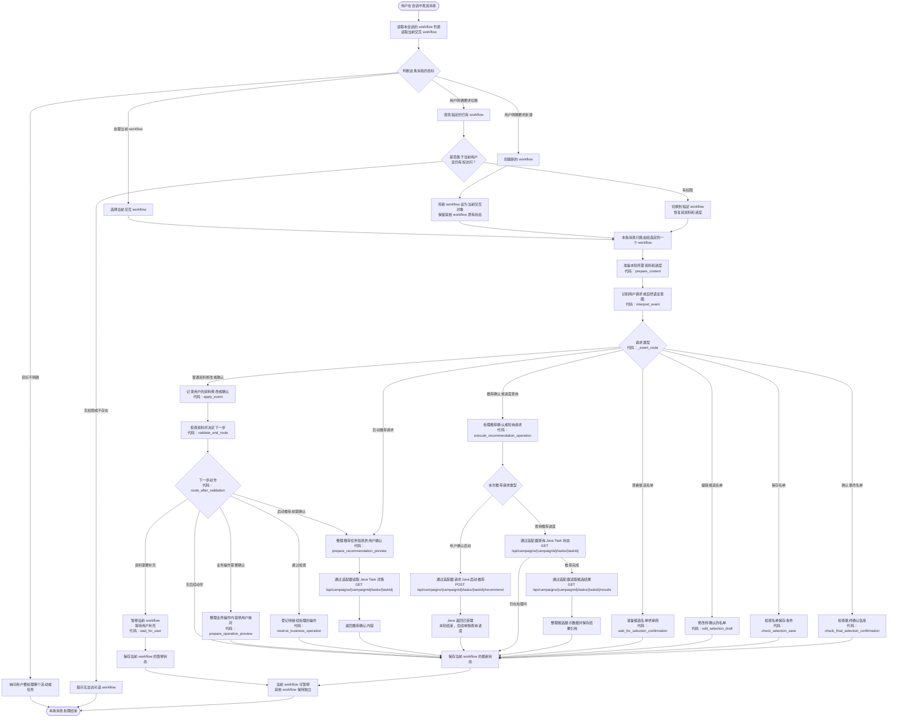
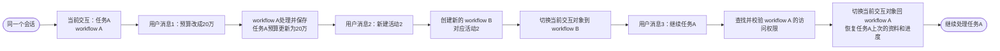
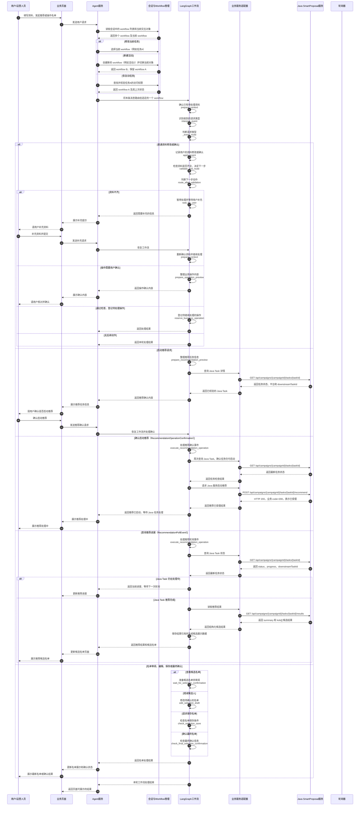

# 智能方案助手：需求预研与技术方案

## 一、工作流节点与流程

这里需要区分：**会话**是用户与 Agent 的连续对话空间；**workflow** 是会话中围绕一个活动或任务独立保存的处理流程。一个会话可以有多个 workflow，但一条用户消息通常只交给其中一个 workflow 处理。图的外层“会话管理与目标选择”来自技术实现文档中的产品流程设计；标有 `代码：...` 的内层步骤对应 Campaign LangGraph 节点。

**通用规则：**用户消息先经过会话层判断目标，再路由给一个明确的 workflow。当前 workflow 可以被修改、暂停或切换；新建 workflow 后，其他 workflow 的资料和进度继续独立保留；恢复已有 workflow 时，先校验访问权限，再恢复其资料和进度。

可单独导入 ProcessOn 的完整版在 [ProcessOn流程图.mmd](./ProcessOn流程图.mmd)；只展示 A→B→A 切换场景的简化版在 [ProcessOn多Workflow场景.mmd](./ProcessOn多Workflow场景.mmd)。两份源码均可粘贴到 [ProcessOn Mermaid 编辑器](https://www.processon.com/mermaid)。

这张场景图表达的是**同一个会话中的先后操作**：workflow A 没有被删除或覆盖，只是暂时不作为当前交互对象；workflow B 创建后成为当前对象，用户明确要求“继续任务A”时再切回 A。

**Java 推荐服务调用：**`prepare_recommendation_preview` 先通过适配器查询 Java Task 详情；用户确认后，`execute_recommendation_operation` 再次读取任务状态并调用 Java 推荐启动接口。Java 返回“已受理”表示接受任务，本轮处理结束；后续由新的 `RecommendationPollEvent` 查询进度。只有 Java Task 进入推荐完成状态，才调用结果接口读取候选名单。

## 二、工作流时序图

流程图强调“有哪些步骤和分支”，时序图强调“用户、页面、Agent 服务和工作流之间按照什么顺序交互”。一次用户操作会触发一次工作流处理；如果资料不完整，工作流暂停等待用户补充，用户回复后继续处理。

时序图 Mermaid 源码另存于 [ProcessOn时序图.mmd](./ProcessOn时序图.mmd)，可直接复制到 [ProcessOn Mermaid 编辑器](https://www.processon.com/mermaid) 中生成时序图。

## 三、节点说明

| 程序步骤（代码名称） | 给业务人员的解释 |
|---|---|
| `prepare_context`（准备上下文） | **确认本轮有可处理的活动资料，并准备流程版本信息。**“上下文”就是本轮处理所需的活动资料、当前进度和相关规则，让后续步骤基于同一份信息工作。 |
| `interpret_event`（识别输入事件） | **确认收到的是哪一类请求。**例如修改表单字段、启动推荐、查询推荐进展、查看名单或编辑名单；也可以承接用户对需求的自然语言表达，并将其识别为后续可处理的请求。 |
| `apply_event`（应用用户修改） | **把已识别的修改记入活动资料。**例如更新活动字段、选择活动，或记录用户对某项操作的确认，形成一份可继续检查的待处理资料。 |
| `validate_and_route`（检查资料并决定下一步） | **检查资料是否足以继续，并选择下一步。**信息不完整时请求补充，需要执行操作时先准备确认内容，条件满足时进入对应处理步骤。 |
| `wait_for_user`（等待用户补充） | **在资料不完整时暂停处理并等待用户回答。**用户补充后，系统继续使用更新后的活动资料处理。 |
| `prepare_operation_preview`（准备操作确认内容） | **将准备执行的业务操作和关键信息整理成确认内容，供用户核对。**用户确认后才进入后续操作处理。 |
| `prepare_recommendation_preview`（准备推荐确认内容） | **将推荐任务的目标、范围和必要信息整理出来，供用户确认是否启动推荐。** |
| `reserve_business_operation`（登记待执行操作） | **记录一项已通过前置检查、准备继续处理的业务操作，确保后续处理有明确的操作对象和记录。** |
| `execute_recommendation_operation`（处理推荐任务） | **根据请求类型执行推荐操作。**用户确认启动时，通过业务服务适配器调用 Java 的推荐启动接口；收到轮询请求时，调用 Java Task 状态接口；确认 Java Task 已完成后，再调用 Java 推荐结果接口并把候选结果交给页面展示。 |
| `wait_for_selection_confirmation`（准备查看名单） | **根据用户请求准备候选名单，供用户查看、审阅和确认。** |
| `edit_selection_draft`（修改待确认名单） | **按照用户要求增加、移除或替换候选人，形成新的待确认名单。** |
| `check_selection_save`（检查名单保存请求） | **核对名单是否满足保存条件，并确认保存对象、名单内容和版本信息一致。** |
| `check_final_selection_confirmation`（检查最终名单确认） | **核对用户是否确认最终名单，以及确认所需的活动、名单和版本信息是否完整。** |

**读图提示：**“本轮结束”表示程序完成了这一次请求的处理，不代表整个推荐项目结束。之后用户补充资料、确认推荐、查看或修改名单时，系统会收到新的请求，再从入口开始处理。

## 四、技术选型与实现方式

| 能力 | 推荐技术或方案                                                                                                                                                                                                                                                                                                                                                                                                                                                                                                                                                          |
|---|-------------------------------------------------------------------------------------------------------------------------------------------------------------------------------------------------------------------------------------------------------------------------------------------------------------------------------------------------------------------------------------------------------------------------------------------------------------------------------------------------------------------------------------------------------------------------|
| Agent 工作流 | Python + LangGraph；把助手处理过程拆成可追踪的步骤，并根据用户操作选择下一步；支持暂停等待用户补充或确认后继续。                                                                                                                                                                                                                                                                                                                                                                                                                                                        |
| 自然语言理解 | 大语言模型 + 结构化输出；理解用户描述，把活动名称、预算等信息整理为系统可检查的字段，再经业务规则校验后更新待处理资料。                                                                                                                                                                                                                                                                                                                                                                                                                                                 |
| 语音输入 | 浏览器 MediaRecorder 录音 + `faster-whisper` 批量语音识别。推荐使用 `faster-whisper >= 1.2.1`；tiny	2 vCPU / 2GB 内存	显存 ~1GB	大小~75MB   small 4 vCPU / 4GB 内存	显存 ~2GB	大小 ~480MB。转写结果先回填输入框，由用户确认后发送。                                                                                                                                                                                                                                                                                                                                          |
| 页面表单回显 | 采用“后端权威表单状态 + API 首次加载 + SSE 增量推送 + Vue 3 页面状态管理”：①后端按 `workflow_id` 保存表单完整数据 `form_snapshot`、版本号 `form_revision` 和字段来源；②页面首次打开、刷新或切换任务时通过 API 获取完整快照；③用户修改或 Agent 产生字段变化时，后端校验白名单和当前版本，生成 `form_patch_applied` 增量事件并递增版本号；④页面通过 SSE 接收事件，在 Pinia 或 `ref/reactive` 中更新表单；⑤页面同时校验任务 ID、版本号和事件序号，旧事件不覆盖新数据，冲突时重新获取快照并提示用户合并。这样页面展示的是经过后端校验的结构化信息，回显与最终业务提交分开。 |
| 进度和结果推送 | FastAPI + SSE（服务器向页面持续发送更新）；页面据此显示处理进度、待用户确认事项和推荐结果。                                                                                                                                                                                                                                                                                                                                                                                                                                                                             |
| 会话与工作流恢复 | PostgreSQL 数据库 + LangGraph 工作流检查点；保存会话数据和处理进度，以便页面刷新或服务恢复后继续查看与处理。                                                                                                                                                                                                                                                                                                                                                                                                                                                            |
