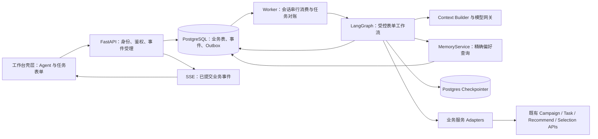
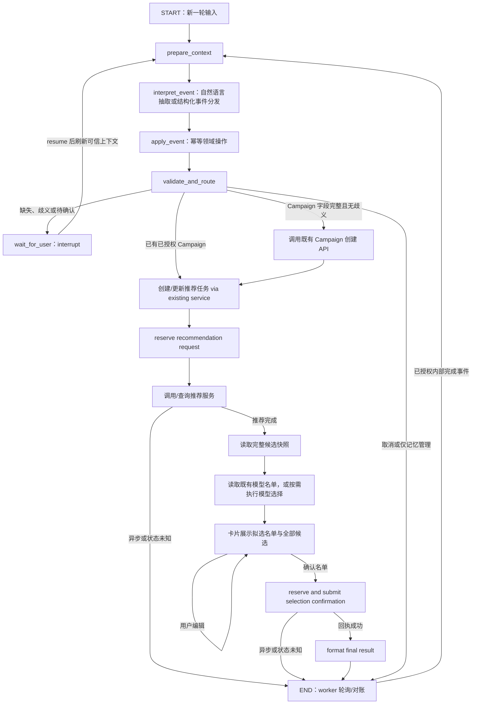

# SmartProposal 第一阶段嵌入式 Agent 技术实现文档

> 状态：评审稿。本文描述目标设计，不代表代码已实现。实施前需由业务、前后端及平台负责人确认文末待决事项。

> 复核日期：2026-11-18。已核对原型、DeepSeek Harness/Codex 相关源码，并在 Smart Social UAT 实际创建 Campaign 和选人任务、启动推荐。本文区分“UAT 实测”“原型设计”和“Agent 新增目标”；浏览器一次成功调用不代表接口的完整契约或幂等/权限承诺。

## 1. 目标与范围

### 1.1 目标

在 SmartProposal 现有工作台中新增 Smart Proposal Agent，参考组合原型的左侧嵌入面板。运营人员用自然语言描述目标，由 Agent 编排现有 Campaign 创建与达人推荐业务能力，补齐活动/产品信息和选人需求；遇到金额、时间、预算归属、平台或筛选条件歧义时暂停并向用户澄清。创建 Campaign 和推荐任务需沿用现有业务服务及授权规则。推荐完成后，Agent 在卡片中并列展示模型拟选的 KOL 名单和全部候选人，用户检查/调整并确认名单后，才调用现有确认名单业务能力。会话、草稿、业务对象关联、请求状态、候选集和确认决定均可持久恢复。

首阶段以“自然语言完成 Campaign 创建流程、歧义先澄清、推荐候选透明展示、用户确认后提交名单、刷新后可恢复”为目标。Agent 不绕过现有 Campaign/任务/名单服务直写业务表；已有创建或推荐 API 是否需要新增草稿/幂等包装，需由接口盘点确定。

### 1.2 包含范围

- 主业务工作台左侧嵌入式聊天面板及其后端闭环，包含收起/展开。
- Campaign 创建全流程编排：收集/校验产品和活动信息，调用现有 Campaign 创建能力；创建/更新选人任务；调用现有推荐能力；将模型推荐名单和完整候选池交给用户确认；确认后调用现有名单确认能力。
- 消息发送、阶段状态反馈、结构化表单 patch、歧义澄清、按既有 Campaign 业务语义执行创建、候选人卡片与名单最终确认。
- 当前用户可见的历史会话列表、打开旧会话、恢复 pending 问题/表单/任务状态并继续聊天。
- 用户/租户/品牌范围鉴权；会话、消息、任务、请求、记忆的 PostgreSQL 持久化。
- 适用的长期偏好查询和明确记忆管理；品牌间隔离以及字段来源展示。
- 运维所需的事件去重、执行幂等、错误恢复、审计及基础可观测性。

### 1.3 不包含范围

- 独立 Agent 首页、通用多入口 Agent 工作台。`SmartProposal Agent DEMO/index.html` 仅作聊天交互参考。
- 智能问数、数据分析、多 Agent 路由、自由调用工具或任意数据库访问。
- 第一阶段自动学习并直接激活行为推断的偏好；行为信号最多形成待确认候选。
- 以语义相似度搜索个人长期偏好；偏好召回使用带权限条件的结构化精确查询。
- 在没有业务确认和数据源定义前，对历史会话/活动案例执行在线向量检索。
- 未经确认直接提交最终 KOL 名单，或绕开现有业务服务直接改写正式业务表。
- Campaign 创建自动化遵循现有创建 API 的校验/提交规则，不额外增加预览确认门槛；输入歧义时必须先澄清。最终 KOL 名单必须由用户在候选卡中确认。

## 2. 原型映射与产品行为

组合原型 `SmartProposal Agent DEMO/proposal.html` 明确了左右布局：左侧约 360px 的 Agent 面板，右侧为完整 SmartProposal 工作台（原型通过 iframe 默认打开活动列表）；Agent 可收起并通过浮动入口重新展开。快捷入口还展示了 KOL 分层总结、Pre-Check 查询和内容洞察，但这些入口不意味着首阶段都要实现。首阶段交付 Campaign 创建、推荐及最终名单确认闭环。

原型页面各自承担不同职责：

| 原型 | 已展示的内容 | 首阶段对应关系 |
|---|---|---|
| `SmartProposal Agent DEMO/proposal.html` | 360px 左侧聊天、收起/浮动展开、右侧 iframe 活动列表、静态回复 | 嵌入位置和交互参考；没有真实页面读取、填表或执行能力 |
| `SmartProposal Agent DEMO/index.html` | 独立聊天页及 Insights/Brief/Proposal/Script/Review 入口 | 只参考聊天样式；不作为首阶段首页 |
| `SmartProposal DEMO/smart-proposal-campaign-create.html` | 产品信息/活动信息两步表单、平台预算分配、活动 KPI | Campaign 创建流程的字段和步骤原型；实际业务页面及服务已存在，本次由 Agent 编排调用，不替换旧实现 |
| `SmartProposal DEMO/smart-proposal-task-create.html` | 上方活动/产品信息折叠卡、下方推荐任务表单、Tier/KPI 弹窗 | 推荐任务创建步骤的字段原型；实际创建能力已存在，由 Agent 适配现有业务服务 |
| `SmartProposal DEMO/smart-proposal-task-list.html` | 任务进度“需求 → 选取 KOL → 确认 KOL 名单”，推荐中/完成/失败状态 | 现有业务流程状态和任务关联的原型参考 |
| `SmartProposal DEMO/smart-proposal-kolRec-detail.html`、`smart-proposal-selection-tier-confirm.html` | KOL 详情、已选数量/金额、确认名单入口和名单确认页面 | 最终候选/拟选卡片的信息层级及既有确认操作参考；Agent 卡片为本次新增 UI |

所有 Downloads 下的 DEMO 目录均为原型，不是真实源代码或可运行的业务实现。用户确认 Campaign 管理、Campaign 创建和选人业务已经在正式系统实现；新增 Agent 应调用/编排正式服务，不从静态原型推断 API，也不复制这些既有页面后另建一套业务真相。原型中页内“AI 需求助手”和组合页左侧 Agent 只是两个交互概念；本次目标 Agent 是左侧 Smart Proposal Agent，是否保留页内入口由产品决定，若保留必须进入同一会话/task/service。

生产集成建议由工作台壳层承载 Agent，保持跨业务路由的会话；不因原型使用 iframe 就默认生产也采用 iframe。若生产必须跨 iframe 通信，需明确受限 origin、消息 schema 和业务对象鉴权。面板与当前活动/选人任务建立明确关联，不能在切换业务页面时误用旧活动表单。目标路由、窄屏行为、产品导航的相对位置及主表单实际字段绑定需在 UI/API 评审中确认。

Agent 的回答不能与表单状态各自为真：聊天产生的字段 patch 和用户直接编辑表单都必须进入同一后端表单合并/校验流程。表单项应显示来源，例如“本次输入”“个人在当前品牌下的偏好”“品牌默认值”；必填缺失、歧义和接口不支持的条件要显式呈现。

历史会话列表是首阶段新增要求，建议作为 Agent 面板中的可展开列表/抽屉，而非新增独立首页。列表项最少展示标题（可从首条用户输入生成，用户可改名是否首版支持待定）、品牌、最近活动时间、状态摘要。默认只列出当前用户有权访问且与当前工作区/品牌策略匹配的会话。选择历史会话前由后端鉴权；跨品牌恢复是否允许需依据用户品牌授权，并在切换时重新校验品牌配置和记忆。不能仅用前端隐藏列表项代替后端授权。

### 2.1 Campaign 与推荐任务字段映射草案

字段适配以 2026-11-18 UAT 观察到的请求为起点，最终与维护方 schema/OpenAPI 核对。内部草稿允许缺项，Adapter 映射到现有 camelCase 请求；不得根据原型自动扩充必填和业务能力。

| UAT 活动/产品字段 | 观察到的请求字段 | 约束和证据 |
|---|---|---|
| 活动标题、活动类型 | `name / type` | 页面标必填；类型选项为 Always On、Occasions、Shopping Festival、Branding Event、New Launch |
| 平台需求 | `platform` | Campaign 级单选；本次可见选项只有抖音，实际提交值 `Douyin`；其他平台须读取现有平台字典，不假定小红书已支持 |
| 品牌 | `brandId / brandName` | 从授权品牌上下文解析；路由名称和 ID 不是授权依据 |
| Campaign 周期、总预算 | `startDate / endDate / budget` | 本次均留空字符串且成功保存；内部用可空类型，Adapter 按契约转换。不能仅因缺少可选日期或预算阻断创建 |
| 画像、情境描述 | `persona / emotion` | 画像页面标必填；情境描述留空保存成功，详情页标签为“情绪” |
| 产品名称、产品卖点 | `product / sellingPoint` | 第 2 步页面标必填；不生成未有证据的真实产品功效 |
| 核心沟通卖点、竞品 | `coreSellingPoint / competitors` | 页面无必填标记；详情中“核心沟通买点”与创建页文案不同，映射同一请求字段 |
| 活动编号、负责人、创建时间 | 未出现在本次创建请求中 | 由现有系统管理；编号在填写标题/类型时变化，不当作数据库 ID 或幂等键 |

| UAT 选人任务字段 | 观察到的请求字段 | 约束和证据 |
|---|---|---|
| 活动名称（任务表单） | `name` | 指选人任务名，独立于父 Campaign 名称；本次填测试名，空值策略仍需契约确认 |
| 达人数量、预算 | `kolCount / budget` | 页面标必填；本次请求为字符串 `"2" / "20000"`，响应为数值；内部使用整数/Decimal，不用二进制浮点金额 |
| Tier 分布 | `tierDistribution` | 页面标必填的自由文本，本次 `Tier3:2人` 成功建任务；不等于已验证下游理解其分布约束 |
| Talking Angle | `talkingAngle` | 文本输入；本次填写测试说明 |
| 达人类型 | `talentType` | 页面标必填，标签增删；本次提交单标签字符串“单品种草型达人”；多标签编码需核对，不能自行假定数组或逗号拼接 |
| 场景、内容偏好、达人能力 | `scene / contentPreference / talentAbility` | 标签选择；本次空字符串创建成功；内容偏好与达人能力须保持字段独立，即使当前候选文案有重复 |
| 备注 | `remark` | 本次请求包含空字符串；页面未观察到独立输入，不强行向用户索要 |
| 任务平台 | 创建请求未携带；任务响应 `platform=Douyin` | 本次与父 Campaign 相同，需核对后端继承规则；不能另设一个必须澄清的任务平台字段 |

**与原型的差异**：UAT 当前为“活动信息 → 产品信息”，Campaign 不含 KPI 或平台预算拆分组件；任务不含独立平台/KPI 下拉或 Tier 数值弹窗，使用“达人类型、内容偏好”而非原型“内容类型、KOL 要求”。KPI、平台预算拆分、Tier 单人金额上限等暂列未来业务改造/接口扩展，不进入当前必填 schema 或上线验收。用户提出这些条件时，先判断现有服务是否支持；不支持则明确反馈并保留需求，不伪称已执行过滤。

Agent 的澄清针对缺少必填、输入歧义或约束冲突；可选项未提供可以留空，有输入但含义不明则澄清。字段长度、数值范围、Tier 字典/分配规则、币种/税费及预算硬约束仍需业务契约确认；不能将 UI 的一次接受等同于所有下游校验通过。

### 2.2 页面关联与编辑协议

前端向后端提交 `page_context`，只包含允许的页面类型、`campaign_id`、已知业务任务 ID、页面对象版本；后端重新读取并鉴权，不接收整页 DOM/任意 URL 作为可信业务事实。Agent 的 `task_id` 是本服务草稿标识，现有 SmartProposal 业务任务 ID 使用独立 `business_task_id`，外部异步 job ID 使用 `external_job_id`，避免三个概念混用。

用户打开另一个活动或恢复旧会话时，先比较当前页和会话编排草稿的 brand/campaign/task 关联。相同则绑定；不同则展示关联差异并让用户显式选择进入原任务或新建流程草稿。页面导航本身不触发创建；Agent 根据用户明确的新建需求，在字段完整且无歧义后按既有 API 创建 Campaign，并遵循正式 API 自身的校验/提交规则。创建推荐任务前必须取得有效 campaign_id。后台轮询结果归属原 request/task，不覆盖新页面。

完整 Agent 流程按现有业务服务契约编排为：用户描述 Campaign 目标 → 提取 Product/Campaign 字段并澄清关键歧义 → 调用现有 Campaign 创建 API 并取得正式 `campaign_id` → 收集推荐 task 条件并调用现有创建任务能力 → 调用/查询已有推荐能力 → 将既有模型选人结果（或仅在现有能力不做选人时由 Agent 生成的名单）和 full candidate pool 投影到确认卡 → 用户增删、替换或确认 → 调用正式名单确认服务 → 展示确认回执及跳转现有 Campaign/名单页面。Campaign 已存在时允许用户显式选择该 campaign 后从中途开始，不重复创建。失败时保留上一步成功的业务对象 ID 和状态，以查询/对账恢复，不从头重建造成重复 Campaign。

Campaign 创建请求按 2.1 节映射 UAT 现有字段。自然语言可以跨步骤一次提供活动和产品信息，Agent 不必机械模拟点击顺序，但必须通过同一业务校验。未提供的可选周期/总预算允许留空；用户已经提供但含义不明的预算、日期或矛盾条件进入 `awaiting_clarification`。必填完整、关键歧义消除后自动调用创建 API，不增加专属预览确认。Campaign 创建后修改走现有编辑服务，不能用创建请求重试隐式再建。

### 2.3 最终候选人确认卡

结果需要返回推荐 task/run 身份、数据快照时间、结果集合及服务的推荐/备选标记。UAT 页面初始仅显示 2 位，点击“查看更多”后显示 4 位；结果 API 记录包含 `source=recommend/backup`、`kolDetail.shortlist/backup`。因此初始展示数不是候选全集，服务维护方须确认推荐集合、备选集合和完整结果版本。`summary.shortlistCount` 是用户已圈选人数（初始为 0），与 `kolDetail.shortlist` 的模型建议语义不同。既有推荐服务已负责模型选人时 Agent 不重复选人；仅接口明确没有选人逻辑且候选全量可取时才实现 `select_candidates`。

最终卡片分为两个有明确标题的区块：

| 区块 | 展示与操作 | 用途 |
|---|---|---|
| AI 推荐 | 服务返回的 `source=recommend` 或确认过语义的 `shortlist=true` KOL，展示有序结果及可追溯依据；用户可圈选/取消 | 展示模型推荐集合，不把 source 或理由文本猜成用户选择 |
| 备选/更多结果 | “查看更多”展开的 `source=backup`/备选 KOL，数量与范围以完整 results 契约为准；可圈选/取消 | 让用户检查推荐集合之外的备选者 |

卡片显示 Campaign、推荐任务、平台、条件摘要、模型推荐数、备选数、用户已选数、已选金额和各自来源。UAT 结果页选择 1 位后显示已选 1/2、预计金额 15,000，并调用 `batch-select`；该写操作的业务副作用尚未确认，不能认定为暂存或最终确认。默认展示 2 位不构成全部候选；“查看更多”展开 4 位，完整性须由 results 契约的 total/cursor 或完整快照保证。候选范围未确认前，Agent 不向用户声称已展示全部候选。

最终确认请求绑定 `campaign_id + business_task_id + downstreamTaskId + selected_kol_ids + selection_revision + user_id + confirmation_id`；下游提供候选版本时再绑定 candidate snapshot version/hash。任何加减/替换递增 revision，使旧确认失效。UAT 已观察到 `POST .../tasks/batch-select` 发送 `{items:[{taskId,kols:[{kolBackendId,selected}]}]}`，成功后仍停留在推荐结果页，未证实它等同最终名单确认。实现前需核实它是 autosave、批次选择还是正式提交；未核实前 Agent 草稿编辑与正式暂存分开，只有明确的最终确认动作才调用最终确认接口。未知结果先对账，不能重复提交。

结果为空或详情加载失败时不展示可提交名单确认，保留任务状态和错误。UAT `recommendation_reason` 为类似 Python dict 的普通字符串，作为不可信文本展示，不调用 `eval`；应优先要求下游结构化依据。指标缺失显示“未提供”，不把汇总预测值 0 冒充真实预测。模型推荐/备选标记、用户圈选集合和最终确认集合分开保存。

表单编辑携带 `expected_form_revision`，名单编辑携带 `expected_selection_revision`；服务端拒绝旧版本覆盖并返回当前快照。聊天修改针对处理时的权威草稿解释，确认绑定用户看到的对应预览/名单卡。前端收到旧 task 或旧 revision 的回包时，不覆盖当前编辑区。

### 2.4 原型以外的首阶段产品决策

历史会话、新建会话、品牌切换、恢复 pending UI 和请求状态虽不是 `proposal.html` 当前实现，仍属于首阶段需求；UI 需要新增清晰入口。历史默认按 owner 展示，跨品牌访问按请求时授权再次校验；被撤权后拒绝内容读取、订阅和恢复。

组合页快捷入口中的 KOL 分层总结、Pre-Check 查询、内容洞察，以及独立页的 Insights/Brief/Script/Review 均不因视觉上可点击而进入首阶段范围。选人原型的 AI 助手加载遮罩和静态 Demo 回复也不作为生产 UI/服务验收行为。

### 2.5 UAT 实测记录与集成依据（2026-11-18）

测试环境：`https://smart-social-uat.platform-loreal.cn/proposal-portal/`。在用户授权下新建 `Agent UAT Flow Test 20261118`，返回 Campaign ID `36`；其下建立 `Agent UAT Selection Test 20261118`，返回业务任务 ID `55`，启动推荐、等待完成、打开结果、展开备选并圈选 1 位。`batch-select` 已被调用，但最终确认步骤尚未核实。测试对象及该 1 位圈选记录保留供业务复核；未删除其他活动或修改既有 Campaign。

| 实际页面/操作 | 实测行为 | 对 Agent 实现的约束 |
|---|---|---|
| `#/campaign/activityList` → “+ 新建Campaign” | 进入 `#/campaign/new?brandId=16&brandName=Armani` | 复用品牌上下文；后端仍鉴权，不相信 URL 中 brandName |
| 新建第 1 步“活动信息” | 标题、类型、平台、画像标必填；周期/总预算/情境可空 | 必填规则按业务 schema；不能照搬原型的产品优先顺序或 KPI/平台预算拆分 |
| 第 2 步“产品信息” → “保存” | 产品名称/卖点标必填，另外两项无星号；保存直接创建并跳转 `#/campaign/detail/36`，未出现额外确认弹窗 | 活动和产品字段合成一次创建请求；UI“下一步”不等于已建活动 |
| 详情 → “新建选人任务” → “创建任务” | 同一详情页内展开表单；创建后卡片状态“待开始” | 建任务与启动推荐是不同操作，不应在创建响应中伪报推荐开始/完成 |
| “开始推荐” | 独立 POST；响应成功后任务 `status=in_progress`、`progress=0`，随后页面观察到 42% | HTTP 成功表示启动已接受，终态和候选需后续查询；不能重复启动来“刷新进度” |
| 推荐完成 → “查看推荐结果” | 结果页初始显示 2 位，点击“查看更多”后显示 4 位（推荐与备选） | 初始可见人数不是结果全集；必须明确结果总数/分页和推荐/备选边界 |
| 推荐结果圈选 | 选择 1 位后显示 1/2、预计金额 15,000；调用 `POST /proposal/api/campaigns/36/tasks/batch-select` | 当前圈选是下游写操作；最终确认 endpoint、取消和幂等语义尚未核实 |
| AI 需求助手、字段标签建议 | 详情已有页内 AI 识别入口和 presets 服务；本次未调用 AI识别 | 可复用现有解析能力，但其澄清、权限、完整性需核验，不复制为第二套无状态 Agent |

**观察到的业务接口**（同站点；仅记录方法/路径、非凭证字段及响应语义）：

| 接口 | 本次响应/行为 | 待补足的契约 |
|---|---|---|
| `GET /api/brand/list-by-current-user` | 页面通过此入口读取品牌列表 | 服务端可信身份传递、授权检查和缓存失效 |
| `GET /proposal/api/platforms` | 返回 `[{code: "Douyin", description: "抖音"}]` | 字典版本及其他部署/品牌平台差异 |
| `GET /proposal/api/brands/by-name?name=Armani` | 创建页发起品牌解析 | ID/name 校验及同名歧义 |
| `POST /proposal/api/campaigns` | JSON 为活动与产品字段；`{code:200,data:36}` | 错误码、边界校验、重复请求处理和幂等能力 |
| `GET /proposal/api/campaigns/{campaignId}` | 创建后读取详情 | 对象版本、编辑契约和权限 |
| `POST /proposal/api/campaigns/{campaignId}/presets` | 输入 `{spu: 产品名}`；返回匹配信息及 scenarios/creator_types/content_preferences/creator_capabilities | 预设为候选标签，不是自动生效偏好；字段映射按响应 key |
| `POST /proposal/api/campaigns/{campaignId}/tasks` | 返回 `{code:200,data:55}` | 多标签字符串编码、必填范围、任务配额和幂等 |
| `POST /proposal/api/campaigns/{campaignId}/tasks/{taskId}/recommend` | 本次请求 `{}`；HTTP 200 且业务 code 200，无候选列表 | 重入/重试策略、超时处理及下游幂等 |
| `GET /proposal/api/campaigns/{campaignId}/tasks` | 响应含 `status/progress/recommendCount/selectedCount/platform/downstreamTaskId` | 终态枚举、进度来源、推荐结果/全量候选读取及最终确认接口 |
| `GET /proposal/api/campaigns/{campaignId}/tasks/{taskId}/results` | 返回 `data.summary` 和 `data.kols[]`；每条含稳定 `kolBackendId`、`source`、`kolDetail.shortlist/backup`、指标、报价和理由 | 是否完整、是否分页、候选快照版本及模型标记权威性 |
| `POST /proposal/api/campaigns/{campaignId}/tasks/batch-select` | 本次 body 为 `items:[{taskId,kols:[{kolBackendId,selected}]}]`，响应业务成功 | 是暂存/增量/全量替换还是正式提交、缺席 ID 含义、并发和重复请求规则 |

本次 `recommend` 成功后的业务任务为 `in_progress`，`downstreamTaskId` 是后续对账引用；Agent 自身 `request_id` 仍需保留，不能把两者混用。Adapter 必须同时校验 HTTP 状态与响应体 `code`；此处看到的 `code=200` 不是所有业务错误都使用非 2xx 的保证。创建 Campaign/任务的业务 ID 本次为数值，不能硬编码为 UUID。

presets 响应的 `matched` 可包含 `match_strategy=brand_fallback`，不得向用户描述为精确产品匹配；返回的标签选项只有用户采用或正式默认策略明确指定后才成为需求。本次页面“达人能力”的候选文案与“内容偏好”重复，但 presets 两组值实际不同；Agent 应按各自响应 key 映射并与前端维护方核对，不能复制页面显示错误。`summary.shortlistCount` 初始为 0，而 `kolDetail.shortlist` 可表示模型建议，两者不可混用；`source=backup` 的理由文本可能仍写 `role=shortlist`，不能从理由文本反推角色。理由文本本次还出现与测试产品不一致的产品名称，需核验下游 brief 组装、缓存和回退来源；此次仅证明调用链路完成，不证明推荐理由真实或所有条件都生效。

最终确认、撤销圈选、推荐未知终态、结果重试及完整候选分页仍需正式 API 规范和额外 UAT 样本确认；浏览器本次只验证到 batch-select，没有执行最终名单确认。

## 3. 技术选型与职责边界

| 层 | 技术/边界 | 主要责任 |
|---|---|---|
| Web/API | Python、FastAPI、Pydantic | 登录上下文、请求校验、品牌权限、事件去重、SSE/状态查询 |
| 工作流 | LangGraph `StateGraph` | 多轮表单处理、澄清、中断/恢复和受控路由；不授予模型执行权限 |
| 关系与任务存储 | PostgreSQL | 会话、消息、任务、表单 revision、推荐请求/结果、记忆、Outbox、审计 |
| 图状态 | LangGraph Postgres checkpointer | 持久化 thread 内工作状态；不作为业务消息档案或长期偏好的唯一事实源 |
| 向量能力 | PostgreSQL + pgvector | 技术栈能力预留。首阶段仅在确认案例语料、权限过滤和产品场景后启用历史案例检索；不用于授权或个人偏好查询 |
| 模型接入 | 统一模型客户端/网关 | 结构化抽取、澄清、摘要及结果解释；模型版本、超时与输出 schema 受控 |
| 外部能力 | Business Service Adapters | 复用正式 Campaign/推荐任务/推荐候选/名单确认服务；字段映射、服务端凭证、超时、下游幂等、状态查询和对账 |
| 异步任务 | PostgreSQL Outbox + Worker | 记忆候选提取、长任务轮询、失败重试和对账；避免依赖进程内后台任务 |

LangGraph checkpointer 保存恢复所需的图状态；`conversation_messages` 保存可展示、审计和引用证据的聊天档案；业务任务表保存当前表单和执行事实。长期记忆通过 `MemoryService` 及自定义表实现作用域、证据、版本、撤销和事务约束。不要同时维护两份可独立写入的长期偏好事实源。

Harness/Codex 参考只用于职责划分：prompt 由固定规则、当前品牌/任务上下文和按节点选择的数据分层组装；业务处理通过受控 pipeline 流转，模型输出经 schema 校验后才由确定性业务逻辑应用；会话历史查询/列表投影独立于模型上下文和底层 checkpoint 格式；存储层持久化显式事件/元数据，不从原始聊天内容隐式推断权限。首阶段不引入其任意命令/文件工具、通用插件系统和多 Agent 生命周期。



### pgvector 首阶段策略

主技术栈保留 pgvector，数据库环境应能安装/升级所需扩展。但其在线业务用途暂不默认开启：首阶段表单默认值和记忆读取要求精确、可解释且先按权限范围过滤，适合普通索引查询。如果业务确认需要“找类似历史活动/历史选人方案”，再建立独立的历史案例索引（向量、来源实体、tenant/brand/owner、有效状态、schema/embedding 版本）；检索必须先做授权过滤，再做向量排序，结果只作参考并要求用户确认。记忆表、会话权限判断、品牌强制规则不得依赖向量相似度。

### 轻量记忆组件评估（2026-11-18）

结论：首阶段交付 PostgreSQL 结构化用户记忆，采用 `MemoryService` 作为唯一业务入口；并以 **memU 自托管核心库作为优先 PoC 候选**，验证跨会话语义召回是否比现有精确查询带来可测收益。PoC 不等于生产选型或已验证集成；无明确收益、权限隔离或删除一致性未通过时不进入生产关键路径。会话恢复仍由消息、业务状态和 checkpoint 负责，不能用语义记忆替代。

| 候选 | 官方资料所述能力与依赖 | 对本项目判断 |
|---|---|---|
| [memU](https://github.com/NevaMind-AI/memU) | Apache-2.0；Python 核心支持本地 SQLite、PostgreSQL + pgvector 和 embedding；自身由宿主 Agent 驱动记忆整理 | 最适合优先 PoC：可复用已有 PostgreSQL，但要验证固定版本的 SDK、embedding、并发、租户过滤及删除；不默认接入其面向个人编码工具的自动采集/云端模式 |
| [Hy-Memory 2.0](https://github.com/Tencent-Hunyuan/Hy-Memory) | Apache-2.0；Python SDK，核心含 ChromaDB/Kuzu，需配置 LLM 和 embedding；Working/Coding 存储可选 PostgreSQL | 第二候选，适合之后验证复杂跨会话事件；核心依赖和独立向量存储增加维护量，不能以 Working 的 PostgreSQL 支持推断整个系统都使用 PostgreSQL |
| [MemOS](https://github.com/MemTensor/MemOS) | Apache-2.0；官方服务自托管示例使用 Neo4j + Qdrant；另有面向特定宿主的 SQLite 本地插件 | 完整服务对第一阶段偏重；本地插件能力和企业多用户服务不可直接等同，可留作后续对比 |
| [OpenViking](https://github.com/volcengine/OpenViking) | 主项目 AGPL-3.0；统一管理资源、记忆及技能，支持自托管 | 能力范围更广；许可证和部署需专项评审，不作为轻量用户偏好首选 |
| [MemPalace](https://github.com/MemPalace/mempalace) | MIT；默认本地 ChromaDB，提供 SQLite/pgvector 等可选后端及 MCP | 适合本地原文检索试验；企业身份、品牌权限及删除链路尚需验证，当前不优先 |

上述描述基于官方项目资料，不代表固定版本的实测结论；基准榜单不是本业务准确率承诺。实施前锁定发布版本和依赖、复核许可证与公司模型/数据部署要求。禁止把 tenant、user、brand 仅作为模型传入的过滤提示：由服务端可信身份建立隔离，验证过滤发生在召回前，缺少隔离保证则不共享索引。个人/品牌记忆的设置、修改、撤销及证据仍由 PostgreSQL 权威表控制；第三方组件只保存可重建的受控检索投影，读取后再次核对权限、状态和版本。删除/撤销须覆盖投影、缓存、备份策略并测试旧异步任务不能复活记忆。不得将默认 embedding 或自动采集配置误认为已获数据处理授权。

PoC 使用经批准的脱敏中文运营样例，对照“结构化精确查询”与“精确查询 + memU 召回”，覆盖同名不同品牌、临时偏好、否定/修改、撤销、跨用户越权及过期记忆。记录召回准确率、错误写入/跨品牌泄漏、P95 延迟、模型和 embedding 成本、依赖与恢复复杂度；阈值由业务和 QA 在测试前约定。未通过隔离或撤销测试即停止试点，不因检索分数提升放行。

## 4. 核心领域对象与持久化

### 4.1 标识和隔离

- `tenant_id`：组织/公司，由服务端登录上下文提供。
- `user_id`：当前登录用户，由可信身份系统提供。
- `brand_id`：当前业务品牌，前端选择但后端校验用户是否有权访问。
- `conversation_id`：用户可见的聊天会话。首版固定绑定 tenant、user、brand。
- `thread_id`：LangGraph checkpoint 线程 ID，由后端映射；不是访问凭证。
- `task_id`：Agent 编排的 Campaign 创建/选人工作流草稿标识；与正式 business task ID 分开。
- `campaign_id` / `business_task_id`：现有业务系统的活动/推荐任务标识，独立于 Agent 草稿 ID；绑定前校验归属和访问权限。
- `form_revision`：有效表单变化时递增；任何变更使既有确认失效。
- `request_id`：一次已确认的 KOL 推荐执行请求，重试复用同一 ID。
- `client_event_id`：前端一次消息/表单操作的稳定幂等键。
- `recommendation_run_id`：一次推荐启动、轮询和结果读取身份；绑定 campaign、business task、downstreamTaskId 及 Agent 保存的结果快照。
- `selection_revision` / `confirmation_id`：用户编辑选择集的版本和最终确认操作身份。

一个会话固定一个 user 和 brand。切换品牌创建新的 conversation/thread；历史会话继续绑定原 brand，不允许客户端通过修改请求字段改变绑定。切换品牌并不是把旧会话改绑至新品牌。

推荐结果有独立的 `recommendation_run_id` 和结果读取快照/hash；UAT 尚未证明下游提供不可变候选版本，若没有则由 Agent 保存返回结果并记录本地 hash，并在提交前重新读取结果核对；本地 hash 不构成下游并发锁。用户编辑选择集用独立 `selection_revision`，最终名单提交用 `confirmation_id`；`batch-select` 写操作单独记录，其语义待核实。它们与 Campaign 创建 operation、业务 task、表单 revision、推荐启动 request 分开，避免把推荐完成或圈选成功误当成最终确认。

### 4.2 主要数据表

具体列、外键、删除策略及索引在开发阶段依据现有身份和 KOL API 契约定稿。

| 表/存储 | 职责 |
|---|---|
| `conversations` | owner、tenant、brand、thread、标题、活动 task、状态、创建/更新时间、schema 版本 |
| `conversation_messages` | 稳定 message ID、会话顺序、角色、正文/结构化事件引用、client_event_id、时间；唯一约束去重 |
| `conversation_events` | 用户操作与面向 UI 的持久化事件：会话内 seq、event/type/schema 版本、payload、client_event_id/body hash、处理状态/租约、关联 message/task/request、时间；用于入站去重、消费恢复和 SSE 补拉 |
| `kol_tasks` | campaign/business task 关联及上下文版本、task 状态、当前 form JSON、字段来源、被 suppress 的默认字段、revision、pending_ui/preview ID、确认版本/hash、结果引用 |
| `kol_requests` | request ID、task/revision、规范化 payload/hash、幂等键、外部任务 ID、状态、错误和重试信息 |
| `campaign_operations` | Campaign create/update operation、稳定幂等键、正式 campaign_id、业务状态和预览/确认版本；不替代正式 Campaign 表 |
| `recommendation_runs` | campaign/task/downstreamTaskId 关联、recommend 受理状态、轮询终态、progress、结果读取时间和结果集版本 |
| `recommendation_candidates` 或受控对象存储 | `/results` 已读取的 `kols[]` 快照、summary、`source/shortlist/backup` 原值及详情；完整性、快照和分页能力须由下游契约确认 |
| `kol_results` | 标准化推荐状态、候选引用和名单确认回执；候选事实以有版本的完整快照/正式服务为准 |
| `selection_confirmations` | 经业务确认后的最终名单操作：confirmation_id、campaign/task/downstreamTaskId、selected IDs、selection revision、actor、幂等键、外部回执；若 batch-select 只是暂存，另存 pending selection |
| `memories` | scope、owner、brand、domain/key/qualifiers、value、状态、版本、有效期 |
| `memory_evidence` / `memory_events` | 记忆证据、版本变化、撤销/删除审计和来源事件顺序 |
| `outbox_events` | 与业务状态事务提交的可靠异步事件 |
| LangGraph checkpoint 表 | 使用官方 Postgres saver 管理，不直接读写或自定义内部格式 |
| （条件启用）`case_embeddings` | 历史案例向量及来源/权限过滤字段；确认语料与检索场景后才启用 |

关键索引建议：会话列表按 `(tenant_id, owner_user_id, updated_at DESC)`；消息按 `(conversation_id, seq)` 且 `client_event_id` 在会话/租户范围唯一；请求对确认 revision 和 execution generation 建唯一约束；记忆语义位置按规范化 scope owner、domain、key、qualifier hash 唯一约束。品牌权限检查需发生在会话、消息、任务、请求、结果和记忆读取之前。

### 4.3 约束、事务与恢复依据

建议核心字段类型：标识使用 UUID 或现有系统标识类型、时间用 `timestamptz`、金额用 Decimal/定点数、表单和事件 payload 用 `jsonb`，状态/revision/归属保留独立列。`conversation_events` 对 `(conversation_id, seq)` 唯一，对非空入站 `client_event_id` 建会话范围唯一约束；消息中的 `client_event_id` 仅用于关联，事件台账承担所有操作的去重，包括没有聊天正文的按钮操作。请求唯一键为 `(tenant_id, task_id, approved_revision, execution_generation)`；generation 只在用户明确再次执行并完成新确认时递增，网络重试不递增。

消息和事件是两个序列：聊天分页使用 message seq，SSE 使用 event seq，不混用游标。会话 event seq 在锁定会话行后分配，并与事件同事务提交，避免 seq 小的事务后提交造成订阅漏读；流只输出可展示事件，内部事件形成的数字间隙不代表丢包。列表使用 `(updated_at, conversation_id)` 稳定排序和游标，并结合 tenant/owner/brand 索引；首版不承诺跨多页查询的全局静态快照，刷新时按 ID 去重。

| 提交点 | 同一业务事务内必须提交 | 提交后的行为 |
|---|---|---|
| 接受输入 | 去重事件、必要的用户消息、待消费 Outbox、列表更新时间 | 返回受理凭据；失败不显示“已受理” |
| 应用操作 | event 处理结果、task/revision/来源/pending UI、必要记忆写入、UI 事件和 Outbox | UI 读取新快照；graph 重放相同 event 不重复改表 |
| 预留 Campaign 创建 | 当前表单 revision/hash、现有服务要求的确认凭据（如有）、唯一 operation/payload 和 Outbox | worker 才可调用既有 Campaign 服务 |
| 完成执行 | request 终态、result 引用、任务状态和结果事件 | 提交成功后推送/显示成功 |
| 名单确认 | campaign/task/run、候选快照 hash、用户 selected IDs/revision、唯一 confirmation/outbox | 调用既有名单确认服务；回执落库后显示最终成功 |

LangGraph checkpoint 与业务事务默认是两个提交点，即使在同一个 PostgreSQL 实例也不能视作原子提交。每个有副作用节点以稳定 `event_id/request_id` 调用幂等领域服务：业务已提交、checkpoint 未提交时，重跑取回原处理结果；checkpoint 指向过时版本时重新读取业务表并核对。不能只依靠 state 中的 `processed=true` 防重。存储“某 event 已应用”的记录需包含对应 revision 和必要输出，以便恢复到正确结果。

Worker 使用短事务领取 Outbox（例如 `FOR UPDATE SKIP LOCKED`）、提交领取租约后再调用模型/接口，期间不持有长数据库事务；完成标记、业务写入都校验当前 fencing token。会话执行器独占 thread 的写入，失去租约应终止后续 graph/checkpoint 写入并退出；官方 saver 本身不负责本应用的租约校验。若超时后仍不能确定旧 graph 已停止，先隔离该运行并对账，禁止并发 resume。下游仍需幂等键，因为本地 fencing 不能收回已经发出的外部请求。

### 4.4 表单和来源

以既有业务 API 契约定义 `CampaignDraft`、`RecommendationTaskDraft`（允许未填）与严格校验的阶段请求 schema。LLM 输出当前阶段白名单字段 patch，不重写全表：`set`、适用列表字段的 `add/remove`、`clear`、用户显式的 `use_default`。模型不得自行改变 tenant、user、brand、权限、执行状态、业务对象 ID 或路由。

每字段保存值和 provenance：`source`、`source_id`、`source_version`、更新时间；未填 (`None`)、显式不限/空集合、被清空且禁止旧默认回填必须有清楚语义。页面表单编辑生成同一 patch，不单独绕开业务校验。

默认值解析顺序：本轮明确输入/手动表单编辑 > 当前 task 已确定值 > 当前品牌下有效的个人偏好 > 允许跨品牌的通用偏好 > 品牌默认 > 系统默认。品牌强制规则、用户权限是约束，不是默认值；记忆不能放宽两者。只为未设置且未被 `suppressed_defaults` 屏蔽的字段补值。默认值进入 task 后保留快照，记忆后台更新不静默改写用户正在处理的表单。

## 5. API 与前端事件

建议 API（最终前缀、认证方式和分页约定遵循现有服务标准）：

| API | 用途 |
|---|---|
| `POST /api/agent/conversations` | 在已授权 brand 下创建会话/初始 task |
| `GET /api/agent/conversations?brand_id=&cursor=` | 分页读取当前用户可访问的历史会话摘要 |
| `GET /api/agent/conversations/{id}` | 打开会话快照：消息游标、表单、pending UI、task 状态 |
| `GET /api/agent/conversations/{id}/messages?cursor=` | 分页读取持久化历史消息 |
| `POST /api/agent/conversations/{id}/events` | 提交用户消息、表单 patch、按既有 Campaign 语义的确认、候选选择/名单确认、取消等统一事件 |
| `GET /api/agent/conversations/{id}/stream?after=` | SSE 订阅持久化事件序号之后的进度/结果 |
| `GET /api/agent/requests/{id}` | 查询已授权的推荐请求和结果 |
| `GET /api/agent/recommendations/{run_id}/candidates?cursor=` | 读取候选快照页面、候选总数及版本，逐页鉴权 |
| `GET /api/agent/recommendations/{run_id}/selection` | 读取模型原始拟选集、当前用户选择集及 selection revision |
| `POST /api/agent/recommendations/{run_id}/selection-events` | 幂等更新用户选择集，或提交最终名单确认事件 |
| `GET /api/agent/memories?brand_id=&cursor=` | 查看本人可管理的记忆 |
| `PATCH /api/agent/memories/{id}` | 携带 expected version 更新或停用个人记忆 |
| `DELETE /api/agent/memories/{id}` | 按已定义的删除语义处理个人记忆并记录防复活标记 |

事件携带 `client_event_id`，重复 ID 且内容相同返回原接受结果；相同 ID 内容不同拒绝。服务先持久化用户事件，再排队处理并返回接受状态。SSE 只发送面向 UI 的业务事件，如 `message_delta`、`message_committed`、`clarification`、`form_updated`、`form_preview`、`execution_started`、`execution_finished`、`memory_saved`、`error`，不暴露 LangGraph 完整 state、prompt 或其他品牌数据。客户端以事件序号重连补拉，不能把 SSE 连接断开等同于取消后台执行。

### 5.1 事件信封和响应

统一事件字段为 `client_event_id / type / task_id / expected_form_revision / payload`；`user_message` 允许附带当前阶段的 preview/run 身份，`form_patch` 必须带 expected revision。若现有 Campaign 流程要求确认，则 Campaign 确认绑定业务预览；最终名单确认必须绑定 recommendation run、candidate snapshot hash、selection revision 和 confirmation ID。`cancel` 必须标明取消草稿还是请求取消外部执行。所有创建、选择和确认操作使用白名单事件类型，不接受任意 graph command 或客户端指定 thread ID。

`selection-events` 是统一会话事件受理服务的资源定向入口，必须复用同一事件去重/串行处理逻辑，不另建并行消费者。名单编辑使用 `selection_patch`，提交用 `confirm_selection`，关联服务端生成的当前 selection preview ID；actor 始终来自登录上下文。Campaign 是否需要显式确认只由正式业务流程决定；本 Agent 不新增额外 gate。最终名单用户确认是必需行为。

```json
{
  "client_event_id": "evt-client-uuid",
  "type": "confirm_selection",
  "task_id": "task-uuid",
  "payload": {
    "selection_preview_id": "preview-uuid",
    "recommendation_run_id": "run-uuid",
    "candidate_snapshot_hash": "sha256:...",
    "selection_revision": 4,
    "selected_kol_ids": ["kol-17", "kol-42"],
    "confirmation_id": "confirmation-uuid"
  }
}
```

首次受理建议返回 `202` 与 `event_id / client_event_id / accepted_seq / status=accepted`；此时既不表示模型处理完成，也不表示已创建外部任务。重复操作返回同一受理凭据和当前处理状态。格式/schema 错误 `422`；无登录 `401`；无权访问的对象采用统一 `404`（不泄漏存在性）；幂等键内容冲突和过时 revision/preview 用 `409`。若冲突在排队消费时才发现，通过带 `source_event_id` 的持久化错误事件反馈并提供最新快照；已返回 202 的 HTTP 请求不能随后改成 409。

详情快照至少返回 `conversation / messages_page / active_task / pending_ui / request_summary / event_cursor / schema_version`。快照与 `event_cursor` 在同一数据库一致性读中获取，保证游标之前的修改均反映在快照中；前端随后从 cursor 订阅，即使两次请求间已有新事件也能补到。轮询详情/请求接口可作为 SSE 不可用时的降级方式。

### 5.2 SSE 重连与流式正文

每个可重放事件先存入 `conversation_events` 再发送，信封包含 `event_id / seq / type / schema_version / task_id / request_id / source_event_id / data`，SSE `id` 使用会话 event seq。支持 `after` 或 `Last-Event-ID`，两者不一致时拒绝含糊游标。数据库为补拉依据，进程内通知或 PostgreSQL NOTIFY 仅负责唤醒。先建立监听再补拉并按 seq 去重，或持续按 seq 查询，避免“补拉结束、开始监听”之间丢事件。

首版建议将可见正文 delta 合并成有大小上限的批次，按 `message_id / attempt_id / chunk_index` 入库后发送；最终正文落入消息表并发出 `message_committed`，客户端替换同一消息的暂存内容。失败/中断记录 attempt 状态与已送达文本，重试使用新 attempt，防止拼接两个答案。模型输出的结构化 patch 只有完整解析、验证并提交后才发送 `form_updated`，不将半截 JSON 当生效字段。流事件保留期耗尽或 cursor 无效时，返回明确的重新读取快照指引；不能静默从最新位置开始导致漏结果。

若首版只需要阶段状态反馈，可不流正文 delta，而在最终答复提交后一次性发送。该选择需通过 UX 评审；不能发送未持久化的 delta 后又承诺刷新必能恢复这些文本。SSE 连接期间也需按授权变更通知或有界复核周期撤销访问，不能只在建立连接时鉴权。

## 6. LangGraph 工作流

建议节点及职责：

1. `prepare_context`：注入可信身份，加载品牌、Campaign/API schema 版本、业务对象及适用记忆。
2. `interpret_event`：自然语言抽取当前阶段字段和歧义；结构化 UI 事件走确定性分发。
3. `apply_event`：幂等合并 Campaign/task 草稿 patch，记录 provenance 和 revision。
4. `validate_and_route`：校验必填、规则、跨字段约束和歧义，确定澄清或受控调用；仅正式业务流程要求时才走其确认步骤。
5. `wait_for_user`：持久化问题/预览后 interrupt；恢复时重新加载权限和业务状态。
6. `reserve_business_operation`：在业务台账记录幂等 operation/outbox；遵循现有 Campaign/task API 的校验、保存和确认语义。
7. `run_recommendation`：创建/查询推荐 run，保存完整候选快照引用并轮询到终态。
8. `select_candidates`：如推荐 API 未返回模型拟选名单，则在全量候选快照上生成拟选子集；若 API 已返回，Agent 直接展示并校验。只可输出候选 ID 子集。
9. `wait_for_selection_confirmation`：展示全候选分页和模型拟选卡片，接收用户选择编辑及确认。
10. `reserve_selection_confirmation`：重新鉴权对象和候选版本，校验 selected IDs/revision，事务创建唯一 confirmation。
11. `submit_confirmed_selection`：通过现有名单确认服务调用/查询；unknown 进入对账。
12. `format_result`：依据真实 Campaign/task/名单回执创建进度和 UI 事件。

外部输入在会话级数据库锁/租约下串行处理，配 fencing token 防止租约过期的旧执行器继续写状态。每次恢复 thread 前先验 conversation owner、tenant、brand 和当前权限；thread ID 不可作为 bearer token。LangGraph 版本升级要覆盖中断恢复和未完成 thread schema 兼容回归。



### 6.1 状态、恢复与受控分发

`AgentState` 至少包含 `schema_version / graph_version / task_id / campaign_id / business_task_id / current_stage / incoming_event_id / applied_event_id / form_revision / form_snapshot / field_sources / suppressed_defaults / validation_errors / task_summary / summary_covered_until_message_id / memory_refs / pending_ui / approved_revision / approved_payload_hash / campaign_operation_id / recommendation_run_id / candidate_snapshot_ref / candidate_snapshot_hash / model_selected_kol_ids / user_selected_kol_ids / selection_revision / confirmation_id / request_id / result_ref / task_status`，近期工作消息有稳定 ID。完整候选事实、连接、凭证和运行时服务不放入 checkpoint；state 只留正式服务引用、分页元数据和可恢复所需的选择摘要，所有写操作仍重新读取业务台账及候选快照。

| 运行状态 | 外部事件处理 | 禁止行为 |
|---|---|---|
| 新 thread 或上轮已 END | 普通 input 从 START 进入，显式加载活动 task | 把历史存在等同于必须 resume interrupt |
| `wait_for_user` interrupt | 取得独占执行权后 `Command(resume=已持久化事件)`，从等待点进入 `prepare_context` 刷新规则和记忆 | 用新 run 绕过旧澄清/待确认点；在 interrupt 节点重放副作用 |
| graph 正在运行 | 事件排队，当前 run 完成/中断后顺序消费 | 多实例并行 resume 同一 thread |
| graph 出错且未完成 | 先检查 checkpoint、event 应用记录与 request 台账，再用锁定 LangGraph 版本支持的恢复方式重试 | 把未明下游结果当失败重新创建 request |
| 外部异步请求进行中 | worker 更新请求台账；新编辑可形成新 revision，旧结果保留原请求关联 | 持有会话执行租约等待整个外部长任务；旧结果覆盖新表单 |

结构化表单 patch、候选选择编辑、最终名单确认、取消和记忆设置不经过 LLM 再解释。自然语言才调用抽取模型。Campaign 信息明确且通过既有 API 校验后按正式契约自动创建；歧义则先澄清。用户说“可以”只有在客户端关联当前名单卡且没有同时提出修改时才形成名单确认候选。最终名单提交必须绑定当前 candidate snapshot hash 和 selection revision。不得因模型已给出推荐名单而自动提交名单。

编排状态建议为 `campaign_draft / awaiting_clarification / campaign_selection / campaign_creating / campaign_created / task_creating / recommendation_running / candidate_review / awaiting_selection_confirmation / selection_submitting / completed / partial_failure / cancelled`。`campaign_selection` 表示用户选择现有 Campaign；只有正式业务流程自身要求确认时才增加对应状态。模型建议状态只读冻结；用户选择状态可编辑。创建 Campaign 后失败标记为 partial failure 并保留已创建对象及 operation ID，可从该阶段恢复，不能重建 Campaign。变更 Campaign 条件若现有服务要求重跑推荐，按其版本机制使推荐结果失效；名单编辑递增 selection_revision，旧名单确认失效。

### 6.2 表单确认和执行安全

Campaign operation 记录 form revision、规范化 payload hash、业务 schema/rule version 和来源，用于审计及幂等恢复，不代表需要用户额外确认。名单确认返回 `selection_preview_id / recommendation_run_id / candidate_snapshot_hash / selection_revision / selected_kol_ids`。服务端重读正式对象权限和当前快照并重新验证；旧候选快照或选择 revision 不匹配均拒绝并返回最新卡片。任何名单变化必须先更新 selection revision 再确认。

Campaign create、task create、recommendation、selection confirmation 分别使用稳定 operation/request/confirmation ID，适配层优先复用现有下游幂等能力。超时且下游无按 ID 查询能力时置 `unknown`，不得从头自动重放业务流程。推荐结果轮询到终态后才构建最终名单卡；名单确认是新的副作用请求，即使推荐操作成功也不能复用推荐幂等键。各异步外部 ID 及时落库，由 worker 轮询；关闭面板或断线不取消操作。

推荐完成卡使用结构化投影，候选字段先由正式 API 的可展示/授权字段白名单决定：

```json

```json
{
  "type": "candidate_review",
  "campaign_id": 36,
  "business_task_id": 55,
  "recommendation_run_id": "run-uuid",
  "candidate_snapshot": {"version": null, "hash": "sha256:...", "total_count": null},
  "model_selection": {
    "model_version": "model-id",
    "selected_kol_ids": ["kol-17", "kol-42"],
    "rationale_refs": [{"kol_id": "kol-17", "fact_refs": ["followers", "price"]}]
  },
  "user_selection": {"revision": 1, "selected_kol_ids": []},
  "candidate_page": {"cursor": null, "items": []},
  "actions": ["edit_selection", "confirm_selection", "revise_campaign"]
}
```

以上仅为 Agent 内部投影示例，并非 UAT 接口响应；模型版本、理由引用和分页能力须经契约确认。候选列表需要完整结果和总数，若下游提供分页则支持 cursor；前端不能将单页当成全体。模型推荐、用户选择和最终名单分开存储/标记；确认后以用户集合为提交内容。结果为空、明细不完整或包含快照外 ID 时，不出现可执行确认按钮，仍展示已授权的真实候选及明确错误状态。

取消草稿可直接终止其未提交执行意图；已经提交的请求只有下游确认取消后才能标记 `cancelled`，否则展示“已停止等待，外部任务仍可能运行”。零结果属于真实执行结果，不自动放宽条件再次调用；解释模型失败时仍展示确定性的原始结果卡。模型超时/schema 无效只允许有限重试，重试耗尽保持原表单并反馈错误，不执行部分 patch。鉴权依赖不可用时暂停受保护操作，不能使用旧权限缓存继续提交。

### 6.3 上下文构建与长会话压缩

每次模型调用由节点专用 `Context Builder` 组装固定规则/schema、已授权品牌配置、当前 Campaign/task 表单及 provenance、当前待回答问题、适用记忆、任务摘要和近期完整轮次。抽取节点只看当前阶段字段；候选选择模型只接收本次授权候选及稳定 ID，并强制子集输出；结果解释只看真实业务回执。所有历史会话和列表摘要不自动进入上下文。引用数据中的指令不能改变 system policy 或确定性业务校验。

输入预算由模型窗口减去输出预留和安全余量后确定，可从约 8k–12k token 的应用预算起步评测，不能视为框架默认值。先保留最新输入、当前表单、关键规则和 pending UI；超限依次移除可选案例、旧结果说明、较早对话。固定指令和字段 schema 保持稳定顺序；动态数据按节点裁剪。若必须保留内容本身超限，返回可定位错误并要求缩小输入，不静默截断金额/规则。

上述预算针对对话抽取节点，不能据此截掉候选池。若需本 Agent 执行模型选人，大候选池采用有覆盖记录的分批评估，再对候选评分/证据聚合选择，保存候选覆盖数与批次版本；不能仅对第一页选人后声称考察了全部候选。模型选人所需属性与候选卡展示字段分别裁剪，候选卡仍支持全部授权快照的分页读取。

在工作消息超过配置阈值或任务切换时生成结构化摘要，保留 `task_id / decisions / rejected_options / unresolved / source_message_ids / covered_until_message_id`；关键数字与当前表单交叉校验。摘要只辅助理解，不覆盖表单或创建长期偏好。压缩前确认原文已入业务消息表，使用 LangGraph 支持的删除/替换机制裁剪工作消息；若采用 `add_messages` reducer，仅返回短列表不等于删除旧消息，应按锁定版本验证 `RemoveMessage` 等操作。清理工作上下文不删除历史消息和旧 checkpoint。

## 7. 历史会话查询与恢复

历史会话属于业务产品能力，不应把所有 checkpoint 或消息一次性送入模型。

- 列表查询来自 `conversations` 的轻量元数据，按授权范围、brand 过滤和分页；标题/最后消息摘要等展示字段是投影，不是模型上下文。
- 打开会话先检查 owner/tenant/brand 权限，再读取消息页和当前 task 快照。按需恢复对应 `thread_id` checkpoint，并核对图状态中的 task/revision 与业务表当前版本。
- 如会话处于 interrupt，恢复已存储的 `pending_ui` 原样展示并接收后续输入，不重新生成不同的问题/确认卡；如执行中，显示 request 状态并订阅 SSE；已完成则显示最近 task/结果引用。
- checkpoint 与业务表不一致时，以业务表中的授权、确认和执行台账为准；检查点只恢复图工作状态。对无法兼容的 `schema_version` 给出可恢复错误或执行显式迁移，不静默跳过待确认流程。
- 会话列表的搜索首版可使用标题/消息文本的数据库全文或精确过滤；pgvector 不用于会话授权或默认列表排序。
- 新建会话与恢复旧会话是不同操作；点击新建不复用已有 thread。旧会话继续保持原品牌绑定。

列表/详情 GET 只读取业务投影和消息，不唤醒 graph、不调用模型、不自动重试外部任务。用户提交后续事件时才在独占写入下检查 checkpoint 并继续处理；后台已受理的请求由 worker 独立推进。打开旧会话若发现页面关联不同，按 2.2 节处理，不能将旧草稿推送到当前活动。schema 不兼容时仍可展示已授权历史消息和已有请求结果，并明确暂停继续编辑/执行，直到显式迁移完成。

## 8. 长期记忆与 pgvector 边界

偏好以结构化记录为准，scope 至少支持 `user`、`user_brand`，品牌共享配置由品牌管理员维护。业务默认优先 `user_brand`。明确表达“以后默认/记住/忘记”进入同步校验和事务写入；仅行为观察形成候选，首版不自动覆盖 active 记忆。保存成功后才能向用户确认“已记住”。每条记忆保留证据消息、来源事件顺序、版本、范围、有效期、状态和审计事件；删除/撤销要阻止旧异步提取复活。

个人偏好读取直接按 tenant、user、brand、domain/key、状态、有效期和 qualifiers 过滤。切换品牌加载新 scope。向量检索不是对权限过滤的替代。

### 8.1 明确记忆的写入、冲突和管理

首版只开放经业务批准的 key/qualifier 白名单，业务偏好默认 `user_brand`，跨品牌 `user` 通用偏好需显式允许。提议必须包含操作、scope/key/value、来源事件/消息、可定位证据和必要有效期。后端验证证据归属、值/范围和操作权限，范围不明时先澄清。临时条件、品牌强制规则和身份凭证不能因聊天被写成个人偏好；用户确认整表也不作为主动偏好证据。

写入按规范化语义位置加锁，并以 `(source_event_id, semantic_slot, operation)` 幂等。相同值合并去重证据；明确新设置替代旧版本；设置页编辑携带 `expected_version`，冲突时返回当前版本。跨会话来源顺序使用 MemoryService 在语义位置锁内分配的可信操作顺序：晚消费的异步候选必须核对提取时观察的版本和撤销水位，不能用“最后入库”覆盖较新的显式设置。候选生成/自动建议可在试点后实现，不属于首版必经链路。

记忆操作提交成功后才发送 `memory_saved`。独立记忆管理失败要明确反馈、允许重试，不能伪称已保存；若一轮包含表单修改和记忆操作，预先定义事务结果并分别展示，不能因为推荐成功就把未提交记忆标为成功。前端在 Agent 面板提供“已保存偏好”列表/抽屉，支持查看 scope/来源/有效期、编辑、停用和删除，可复用现有设置入口。

撤销立即停止召回并写防复活水位，拒绝用旧证据重建。恢复旧 checkpoint 时重新验证 `memory_id/version/status`；未执行草稿中仍由该记忆派生且未经用户显式覆盖的字段应移除，递增 revision、使确认失效并重新预览。后台更新偏好的值不静默改写已有草稿；撤销处理是明确失效操作。用户之后手动设置的同值以及已执行请求快照保留其原始来源与审计事实。

“停用偏好”和“彻底删除数据”分别定义：后者按数据策略覆盖值、候选、证据副本、缓存以及可能含该内容的上下文/checkpoint/任务快照；保留哪些审计摘要、聊天原文和备份须有明确期限，不能把一条主表软删等同于彻底删除。

### 8.2 条件启用的历史案例检索

如首阶段评审决定启用案例向量召回：只嵌入经业务批准的已确认历史案例/活动说明，不将完整聊天或敏感个人记忆默认向量化；元数据保留来源实体和权限范围。先做授权过滤，再执行近邻检索；使用结果显示“相似历史案例”来源并让用户选择采用，不能自动覆盖当前表单。必须补充删除同步、重建/版本、embedding 模型升级和跨品牌隔离测试。

授权谓词必须包含在 SQL/数据库访问策略中，不能先取全库 Top K 再由应用过滤；pgvector 的近似索引可能先扫描再过滤，需实测召回不足并选择精确扫描、分区或合适索引策略，不能声称 SQL 书写顺序保证物理执行顺序。“沿用上次确认方案”优先通过已授权 task/request 精确定位并复制为新草稿、重新确认，不需要向量检索。

## 9. 安全、可靠性与可观测性

- 每个读取/写入端点都按服务端可信身份校验 conversation/task/request/result/memory 的归属和品牌权限；禁止客户端注入 `tenant_id/user_id/role/namespace`。
- 品牌强制规则、字段白名单、金额/单位转换、枚举校验、确认状态和请求路由由确定性代码控制。
- 对模型输出、用户消息、历史记忆和外部接口文本均按不可信数据处理；其中指令不能覆盖系统权限或执行规则。
- 记录 `trace_id/conversation_id/task_id/request_id`、工作流节点耗时、模型/prompt/schema 版本、patch/provenance、revision/hash、外部任务状态、记忆读写裁决和 Outbox 重试。按公司数据策略脱敏并控制原文和 trace 留存。
- 按用户/品牌策略定义消息、checkpoint、结果、记忆及向量数据保留与删除；删除记忆不能只删主表而遗留候选、证据副本或向量索引。
- 同一 conversation 的事件串行；跨实例使用数据库租约/锁和 fencing token。事件去重、请求唯一约束与下游幂等分层处理。

部署至少包含 API 和常驻 worker 两类进程；迁移与 checkpointer setup 在部署初始化执行，运行实例复用连接池。模型凭证和 KOL 凭证由服务端密钥管理提供；反向代理配置 SSE 禁缓冲、心跳和连接超时。消息长度、事件速率、模型输出/token、重试次数和 worker 并发设有界配置；记录积压、最老待处理事件、unknown 请求和恢复失败告警。

上线前锁定 Python/LangGraph/checkpoint/Pydantic/数据库驱动版本并验证 saver 连接配置、初始化与关闭流程。备份/恢复同时覆盖业务数据和 checkpoint，恢复后重新对账非终态请求；不能仅恢复 checkpoint 就认定执行台账可靠。SSE 不可用可轮询，模型不可用可保留草稿和手动填表，向量检索可独立关闭。

## 10. 建议目录结构

```text
app/
  api/                 # FastAPI routes、请求鉴权和 SSE
  auth/                # 可信身份、tenant/brand 权限
  graphs/campaign/      # Campaign 到名单确认的 state、nodes、routing、graph
  schemas/              # API、事件、表单、patch、request/result schema
  services/
    conversation_service.py
    context_builder.py
    memory_service.py
    business_service_adapters.py
  repositories/         # PostgreSQL 事务、租约、幂等与 Outbox
  workers/              # 外部任务轮询、记忆候选、对账
  prompts/              # 分版本提示词及结构化输出约定
  migrations/           # 业务表和扩展迁移
  evals/                 # 业务语料、预期 patch 与指标
tests/
  unit/
  workflow/
  memory/
  integration/
```

跨模块公共逻辑按实际重复抽象；多处重复使用的 patch 校验、身份范围构造、request hash 和会话访问检查应集中到领域服务/公共方法，避免 API、Graph node、Worker 各自实现一套语义。

## 11. 验收标准

- 用户可用自然语言启动 Campaign 创建，补齐 Product/Campaign 信息，歧义时先澄清；信息明确后遵循既有 API 规则自动创建 Campaign，再调用任务创建和推荐服务，不新增 Campaign 确认门槛。重复事件/进程崩溃不重复创建 Campaign 或任务。
- 推荐完成后卡片同时显示模型拟选名单和本次全部候选（候选量较大时分页且显示准确总数）；可编辑用户选择并确认，只有用户确认后才调用既有名单确认服务。
- Campaign 创建与名单提交独立记录；最终名单必须由用户确认，并绑定 campaign/task/run/candidate snapshot hash/selection revision/actor，旧版本、未授权或候选集外 ID 均被拒绝。
- 字段来源可识别；修改一个字段不丢失其他已确定字段；`clear`/不限与未提供字段语义一致。
- UAT 字段逐项映射现有 API，产品与活动信息合成一次创建请求；可选周期/总预算不被提升为必填；Tier 文本、达人类型和内容偏好等字段正确往返。KPI、平台预算拆分和 Tier 数值弹窗在业务扩展获批前不作为首版验收。
- 创建任务后可区分 `待开始` 与 `in_progress`；推荐 POST 的业务成功不等于已有名单，依据查询终态读取结果；presets 仅为建议并保留其匹配来源。
- 用户可查看历史会话；无权限用户不能枚举、打开、订阅或恢复其他人的会话/任务/结果；恢复后可继续中断对话且 UI 状态一致。
- 服务重启、浏览器刷新和 SSE 断线后，可重新读到消息、表单、pending UI 和执行状态；重复 client event / 确认不会产生重复外部请求。
- 表单/规则变化使对应旧确认失效；Campaign create、task create、recommendation 和名单确认均不重复产生对象/提交；超时 unknown 不盲目重试。
- 记忆在 user_brand 范围隔离；本次临时修改不覆盖长期偏好；撤销后不被旧消息重建。
- 页面切换/恢复旧会话不误填当前 Campaign；快照到订阅之间新增事件不漏读；业务已提交而 checkpoint 未提交时重跑不重复应用；Campaign 创建后部分失败可从中间阶段恢复。
- 候选卡展示数量与授权完整候选快照总数一致，模型拟选 ID 均属于该快照；用户修改后模型原建议仍可辨认，最终确认仅提交用户当前选择。
- 长会话压缩后金额/否定条件和待确认点保持，历史消息仍可查看；偏好可查看、编辑、停用和删除，撤销后旧 checkpoint 不重新注入。
- 若启用 pgvector，必须通过 owner/tenant/brand 过滤、删除同步、索引重建和跨品牌泄漏测试；否则验收项为扩展安装/迁移策略已评审，但向量检索不在在线路径。
- 确定性安全/幂等/恢复回归全部通过。准备业务验证集，覆盖至少 100 条真实运营表达及多轮修正；语言理解质量目标经业务确认后再设阈值。

## 12. 待评审/确认事项

1. 现有登录系统提供哪些 tenant/user/brand 授权接口？历史会话允许跨品牌展示，还是必须先切换到原品牌？
2. 正式 Campaign 创建、推荐任务创建、推荐、候选查询和名单确认服务分别是什么 API/owner？有哪些现有确认步骤、幂等及状态查询能力？
3. Campaign 创建/保存的既有取消/编辑语义是什么？最终名单确认的业务副作用及撤销规则是什么？
4. 推荐服务可否提供不可变候选快照、稳定 KOL ID、全量分页/总数、模型拟选集合及可展示字段？候选保留和访问策略如何定义？
5. 历史会话标题、分页、搜索、归档/删除和保留期的产品规则是什么？恢复已完成会话后是继续原 task 还是显式新建 task？
6. 首阶段是否已有可用且获批的历史活动/选人案例语料，且确实需要相似案例召回？若没有，pgvector 首阶段只按数据库能力/扩展预留，不上线在线检索。
7. 哪些偏好字段可写长期记忆？品牌默认、硬性规则分别由哪个系统和角色维护？
8. 消息、checkpoint、结果、记忆及其删除/审计保留期限，以及第三方模型/观测平台可接收的数据范围是什么？
9. 原型组合页默认活动列表，另有活动创建和选人任务创建页；需确认目标路由、Agent 与产品 sidebar 的组合、页内 AI 助手入口关系、页面切换持续可见性、窄屏折叠及结果呈现位置。
10. 当前 Tier 自由文本如何传递给推荐服务、多标签编码、人数/预算边界和任务配额需确认；原型额外 KPI、平台预算分配和 Tier 数值字段只有业务明确扩展后才纳入。
11. SSE 是否需要正文流式还是阶段反馈即可；事件保留期、过期游标处理、列表搜索/改名/归档是否首版实现需 UI/API 一起定稿。

## 13. 复核依据与开源参考映射

本轮用户明确：两个 DEMO 目录均为原型图；Campaign 管理/创建等业务能力已在正式系统存在；Agent 的目标是自然语言自动化整个创建流程、遇歧义澄清，并在最终卡片展示模型名单和全部候选供用户确认。此口径覆盖基线技术方案中只讨论 KOL 推荐助手的较窄描述。

本次依据本机源码快照复核，未将其存储格式或安全假设直接移植为业务约定。源文件路径用于评审溯源；它们不意味着已对整个项目做过完整审计或运行测试。

| 参考源码（相对于开源项目根目录） | 已核对的实际职责 | 本项目采纳与限制 |
|---|---|---|
| Harness `packages/core/system-prompt/src/index.ts`：`assemble / refreshContext` | 固定 section、动态 context、tool schema 分开组装，作用域覆盖和顺序明确 | 节点专用 Context Builder、稳定规则与动态业务数据分层；不引入 Cordis 插件注册系统 |
| Harness `packages/core/agent-loop/src/agent.ts`：`preStep`；`src/index.ts`：`resumeWith` | 预执行组装/检查；resume 先取得 write handle，再读日志和处理被中断的 turn | 先取会话写入权再恢复；业务 unknown 对账自行实现，不能用补齐日志代替外部状态核对 |
| Harness `packages/api/session-controller/src/commands.ts`：`prompt / hasPromptRequest` | 通过已记录请求身份恢复受理去重；返回 accepted | API 受理与完成分开；本项目额外校验相同 client event ID 的内容 hash |
| Harness `packages/api/session-controller/src/list.ts`：`list / summarizeCold` | 列表读取元数据/投影，冷会话不激活 Agent | PostgreSQL 会话列表与详情只读、独立于图执行 |
| Harness `packages/session-query/session-query/src/cold-read.ts` 和 README | 只读打开历史；查询基础服务本身不提供调用者授权 | 历史可只读浏览；每条业务 API 自行执行 owner/tenant/brand 鉴权 |
| Codex `codex-rs/thread-store/src/store.rs`、`src/live_thread.rs`：`append_items / resume` | 原始历史追加与显式元数据更新分工；恢复使用取得 writer 后的历史 | 档案、列表投影和执行台账各有所有者；Python/PostgreSQL 实现，不照搬 Rust/JSONL/SQLite 存储 |

业务基线为 `/Users/huajun.yao/Downloads/第一阶段内部运营助手技术方案.md`，原型文件见第 2 节。LangGraph 实现时还需对照锁定版本的 [Persistence](https://docs.langchain.com/oss/python/langgraph/persistence)、[Interrupts](https://docs.langchain.com/oss/python/langgraph/interrupts) 和 [Memory](https://docs.langchain.com/oss/python/langgraph/add-memory) 文档验证 API；本文的业务事务、事件协议和鉴权是本应用设计，不由框架自动提供。
